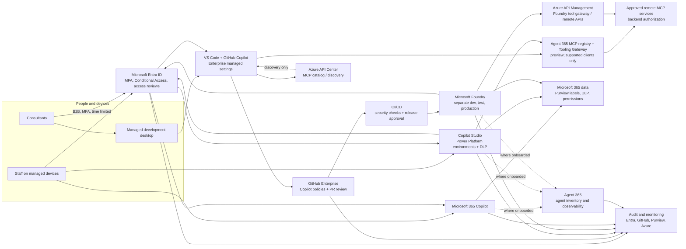
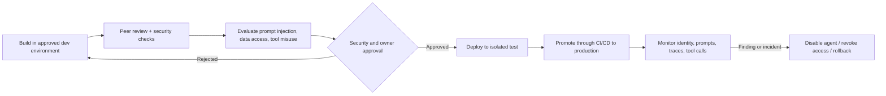

# Enterprise AI and agent security recommendation

## Recommendation

Adopt one enterprise AI policy across Microsoft 365 Copilot and its agent builders, Copilot Studio, Microsoft Foundry, GitHub Copilot, VS Code agent features, and custom integrations. Maintain one inventory, but enforce controls in each product's own control plane.

- **Approve and inventory:** Register each AI service, agent, MCP server, extension, owner, purpose, data access, risk tier, and production status. Separate development, test, and production.
- **Protect users and devices:** Require Entra MFA and least privilege. Give consultants time-limited B2B access. Use company-managed devices or a managed cloud development desktop for source code and sensitive data. For unmanaged access, restrict Microsoft 365 to browser-only sessions with download, sync, and print blocked.
- **Protect information:** Remediate overshared SharePoint and repositories; apply Purview sensitivity labels and DLP. Use managed identities or Entra authentication; keep secrets in Key Vault. Never place secrets in prompts, source, or traces.
- **Restrict agent capabilities:** Require authentication; allow only approved connectors, tools, and MCP servers. Use read-only access by default. Require an external approval gate for consequential writes.
- **Review and monitor:** Require code review and security checks before release. Test prompt injection, data leakage, and unauthorized tool calls. Retain and review audit logs and traces.

## Technical target state

### Enforcement decisions

| Area | Implement with | Key implementation detail |
|---|---|---|
| Staff and consultants | Entra Conditional Access, B2B, Intune; Azure Virtual Desktop, Windows 365, or Dev Box for unmanaged consultants | Require MFA, scope access by group and project, set expiry and access reviews. Prefer a company-managed development desktop for code and sensitive data. |
| VS Code and GitHub Copilot | GitHub Enterprise policies plus Copilot `managed-settings.json`; VS Code device policies on managed installs | Centrally allow approved MCP URLs and commands, limit agent/CLI/plugin features to approved use, and require approved enterprise GitHub accounts. Prohibit personal Copilot accounts for enterprise code. Verify effective policy in VS Code. GitHub cloud agents need separate repository and agent policies. |
| Approved MCP services | Agent 365 MCP registry and Tooling Gateway where supported; GitHub/VS Code managed allowlists; Foundry tool configuration and Azure API Management | Agent 365 provides central approval and runtime blocking for supported MCP clients during preview. Azure API Center is a separate discovery catalog, not an enforcement point. Local `stdio` tools bypass remote gateways, so restrict commands and packages separately or disable them. |
| Foundry agents | Entra RBAC, per-agent Entra Agent ID where supported, managed networking, model/tool allowlists | Assign an owner/sponsor and grant each agent only the downstream permissions it needs. Keep production isolated. Foundry's APIM AI gateway is preview and currently does not cover every MCP configuration, so verify routing rather than assume it. |
| Copilot Studio agents | Power Platform managed environments, environment security groups, data policies, authenticated users, scoped connectors | Block unnecessary connectors/channels, unauthenticated agents, and maker-provided credentials. Use separate environments and a gated ALM release to production. |
| Inventory and operations | Agent 365 / Microsoft 365 admin center where onboarded; product inventories, Entra, GitHub, Azure Monitor/Sentinel | Use Agent 365 for supported inventory and observability, but supplement it with direct product and VS Code discovery. Coverage depends on platform integration and telemetry. Protect traces as sensitive data. |
| Data and actions | Purview, Key Vault, backend authorization, approval workflow | Enforce permissions at the data source and API, not only in prompts. Give the agent no direct high-impact write permission; validate and approve the request, then execute with a separate narrowly scoped identity. |

**Identity caveat:** Entra Agent ID and Conditional Access for agent identities are supported for specific agent products and authentication flows. Pilot in report-only mode and confirm coverage for each product. Conditional Access does not protect calls authenticated only by API keys.

## Approved MCP services: register once, enforce by surface

**Best current central approval point:** Microsoft 365 admin center > **Agents > Tools > Registry** (Microsoft Agent 365). During preview, an administrator can review and approve remote BYO MCP servers, grant the required Entra consent, and block an approved server at runtime. A block is enforced across supported client surfaces. Tool-level blocking for BYO servers is not yet available.

**Preview coverage is limited:** Microsoft currently lists Copilot Studio, Visual Studio Code, Claude Code, and GitHub Copilot CLI as supported clients. Microsoft Foundry and Microsoft 365 declarative agents are explicitly unsupported. The server must have a publicly accessible endpoint. Check licensing, tenant rollout, client versions, and the supported list before adopting this as a control.

| Need | Control point |
|---|---|
| Approve or revoke remote MCP servers across supported clients | Agent 365 MCP Registry and Tooling Gateway |
| Discover/catalog internal APIs and MCP endpoints | Azure API Center. It is a catalog and does not, by itself, block direct connections. |
| Govern GitHub Copilot and VS Code clients | Enterprise-managed `managed-settings.json` allowlist plus relevant VS Code device policies. Verify which clients and agent harnesses each policy covers. |
| Govern Foundry agents | Foundry agent-specific tool allowlists and authorization; use APIM/network controls for remote tools. Foundry's integrated MCP gateway is preview and covers only eligible configurations. |
| Govern local `stdio` servers | Device and package controls plus VS Code/GitHub command allowlists. These local processes do not pass through a remote gateway. |

**Recommendation:** Use Agent 365 as the approval and emergency block point for supported remote MCP clients when available. Keep Azure API Center as the technical catalog if useful. Continue enforcing separately in VS Code/GitHub and Foundry until their paths are confirmed covered. Do not claim a single registry governs every agent runtime.

## Safe release path

## First implementation steps

1. **Inventory and assign owners.** Find all Copilot tenants, Foundry projects, Power Platform environments, VS Code AI extensions, agents, MCP configurations, and external accounts.
2. **Set baseline policies.** Require Entra MFA; make consultant access time-limited; publish GitHub/VS Code MCP allowlists; lock Copilot Studio environments with restrictive DLP; separate Foundry dev/test/prod.
3. **Pilot one low-risk agent.** Use a read-only Foundry or Copilot Studio agent. Prove it cannot call an unapproved tool or access data the user cannot access. Test from both a managed device and the consultant access path.
4. **Add gated production operations.** Put remote tools behind APIM, enforce authorization at each backend, add human approval for writes, and centralize audit evidence before expanding.

## Microsoft references

- [Microsoft Entra Agent ID and Conditional Access](https://learn.microsoft.com/en-us/entra/identity/conditional-access/agent-id)
- [Microsoft Foundry security baseline](https://learn.microsoft.com/en-us/azure/foundry/concepts/planning)
- [Foundry agent identity concepts](https://learn.microsoft.com/en-us/azure/foundry/agents/concepts/agent-identity)
- [Foundry AI gateway for MCP tools (preview and limitations)](https://learn.microsoft.com/en-us/azure/foundry/agents/how-to/tools/governance?view=foundry)
- [GitHub Copilot enterprise MCP allowlist](https://docs.github.com/en/copilot/how-tos/administer-copilot/manage-mcp-usage/configure-enterprise-allowlist)
- [VS Code enterprise AI settings](https://code.visualstudio.com/docs/enterprise/manage-ai-settings)
- [Azure API Center MCP inventory](https://learn.microsoft.com/en-us/azure/api-center/register-discover-mcp-server)
- [Copilot Studio governance](https://learn.microsoft.com/en-us/microsoft-copilot-studio/guidance/sec-gov-phase2)
- [Microsoft guidance for external B2B Conditional Access](https://learn.microsoft.com/en-us/entra/external-id/authentication-conditional-access)
- [Microsoft Agent 365 inventory and observability](https://learn.microsoft.com/en-us/microsoft-agent-365/admin/monitor-agents)
- [Agent 365 BYO MCP registration and supported clients](https://learn.microsoft.com/en-us/microsoft-agent-365/admin/manage-byo-mcp-server?view=o365-worldwide)
- [Agent 365 tool governance](https://learn.microsoft.com/en-us/microsoft-agent-365/guidance/govern-tools)
