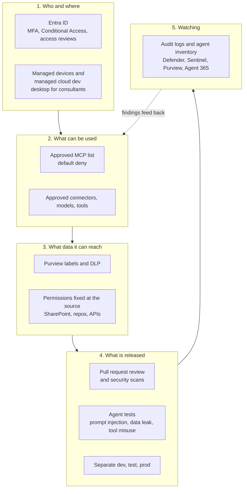
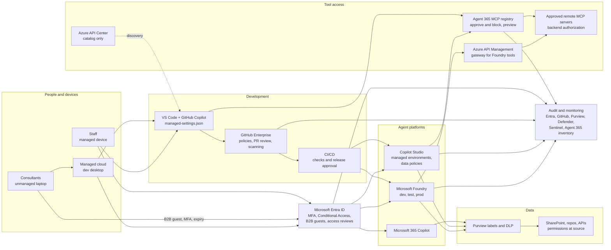
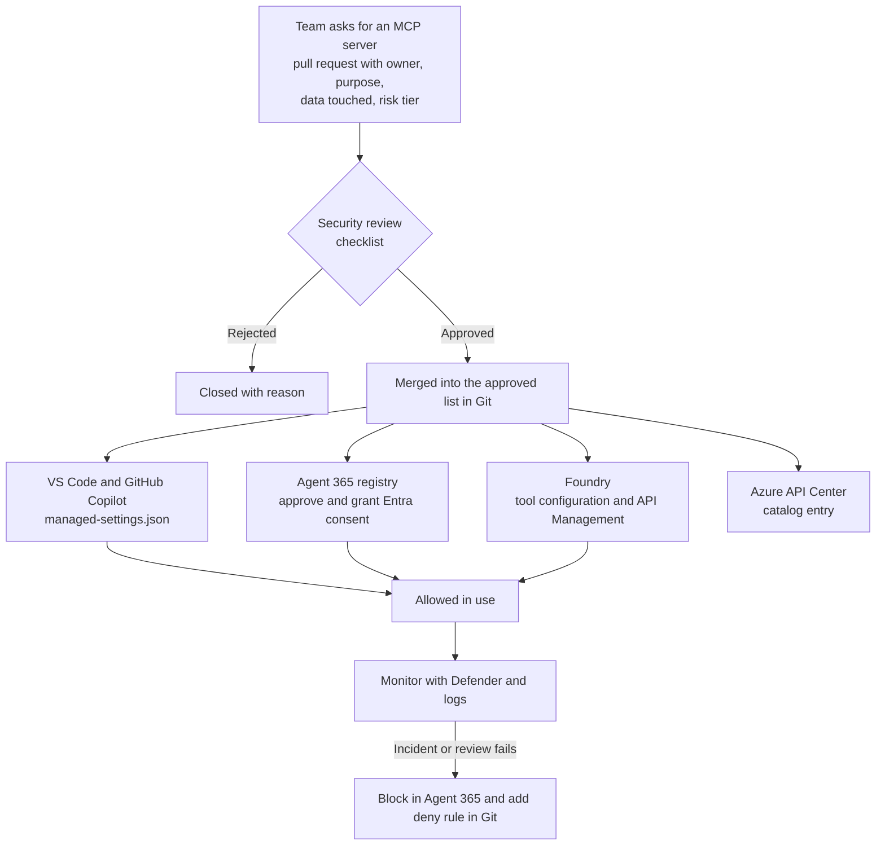
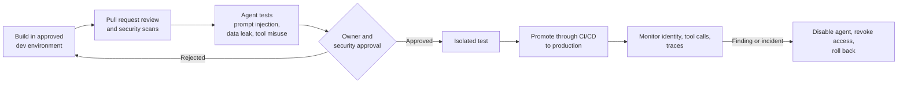

# Safe use and development of AI and agents on the Microsoft stack

**Recommendation for:** Microsoft E7 tenant using Foundry, Copilot Studio, Microsoft 365 Copilot, GitHub Copilot, GitHub and VS Code, with managed devices and external consultants on unmanaged devices.
**Facts checked against Microsoft, GitHub and VS Code documentation on:** 2026-11-05 (eleventh pass, statement by statement)

**How to read the tags**

| Tag | Meaning |
|---|---|
| **[verified]** | Read on the vendor page on 2026-11-05. |
| **[partly read]** | The page was long and only part was read word for word. The rest was read as a machine summary. Confirm before you rely on it. |
| **[recommendation]** | Our design choice. Not a vendor claim. |
| **[inference]** | Reasonable conclusion. The vendor does not say it. |
| **[verified: not stated]** | The vendor pages searched on 2026-11-05 do not say it. The statement is only that the pages are silent. Part 5, item 10 lists these. |

---

# Part 1. Summary

## The answer in one minute

1. **One rule set, enforced in each product's own control panel.** No single Microsoft tool governs every agent runtime today. Do not plan as if one does.
2. **Default deny for MCP servers.** Only servers on one approved list may run. Everything else is blocked.
3. **Keep source code and sensitive data on managed devices.** Consultants on unmanaged laptops work inside a managed cloud desktop (Dev Box, Windows 365 or Azure Virtual Desktop).
4. **Agents get their own identity and the smallest possible access.** Read-only by default. A human approves anything that changes data.
5. **Run it as policy as code.** The approved lists live in Git. A pull request is the approval. This removes most manual admin work.

All five points are **[recommendation]**. The vendor facts that support them are tagged below.

## The big picture



## Which tool does which job

| Job | Main tool | One-line reason |
|---|---|---|
| Who can sign in, from what device | Entra Conditional Access, Intune | Already in E7. |
| Consultant access | Entra B2B guests, access packages with expiry and reviews | Access ends by itself. **[verified]** |
| Safe workplace for unmanaged consultants | Dev Box, Windows 365 or Azure Virtual Desktop | Code stays in the cloud desktop. |
| Allowed MCP servers in VS Code and GitHub Copilot | GitHub `managed-settings.json` allowlist | GitHub's recommended method, generally available. **[verified]** |
| Approve and emergency-block remote MCP servers | Agent 365 MCP registry (Microsoft 365 admin center, Agents, Tools) | One switch blocks a server. Preview. **[verified]** |
| Catalog of internal MCP servers | Azure API Center | A catalog. It does not block anything itself. **[verified]** |
| Copilot Studio guardrails | Power Platform managed environments, environment groups, data policies | Blocks connectors, channels, unauthenticated agents. **[verified]** |
| Foundry guardrails | Entra RBAC, agent identity, network isolation, Azure Policy for models and tools (tools in preview), API Management | Per-agent access, closed network, approved models and tools. **[verified, tool policy is preview]** |
| Data protection | Purview sensitivity labels, DLP for Copilot, SharePoint Advanced Management | Limits what Copilot can use. **[verified]** |
| Agent inventory and monitoring | Agent 365, Defender, Sentinel | Shows who runs what. **[verified, see platform list in 2.9]** |

## What E7 gives you

Microsoft's licensing page says: E7 includes everything in E5 and adds Microsoft Copilot, the Microsoft Entra Suite and Microsoft Agent 365 in a single license. **[verified, page dated 2026-10-28, updated 2026-11-04]**

Agent 365 became generally available on 1 May 2026 for the Commercial segment. It is licensed per user. Microsoft says it "works best when using Microsoft E5 as a pre-requisite". It is also sold stand-alone.

For GCC, Microsoft says Agent 365 and Microsoft 365 G7 can be bought from 1 October 2026, with more purchasing options from 1 November. Features arrive in phases as GCC authorization milestones are met. No GCC High or DoD date was found. **[verified]**

Agent running costs are **not** fully in the license. Copilot Studio usage is metered in Copilot Credits. **[verified]**

Users with a Microsoft 365 Copilot license are not charged when they use agents in Copilot Chat, Teams or SharePoint with their own authenticated identity. The exemption does not apply when an agent runs autonomously, for example after an event trigger. Computer-using agents are not included. Fair-use limits apply. **[verified, Copilot Studio billing pages updated 2026-11-03 and 2026-11-05]**

Foundry model deployments can be billed per token (Global Standard is "Pay-per-token"). Hosted agents in Foundry Agent Service are billed on CPU and memory used across active sessions. **[verified, page updated 2026-10-27]** Foundry's agent overview lists other possible charges, such as Application Insights and voice features. **[verified]**

Microsoft's Azure pricing page for Foundry Agent Service says there is no extra charge for creating or running Foundry-native agents built with prompts and workflows. You pay for model tokens, and separately for tools and knowledge connections. Hosted agents are billed on container compute per hour. **[verified, page read 2026-11-05, undated]**

Microsoft's launch post says E7 became generally available on 1 May 2026 at $99 per user per month, with and without Teams. Agent 365 is also sold alone at $15 per user per month. The E7 page on microsoft.com, read on 2026-11-05, shows $99.00 per user per month, paid yearly. These are list prices. Your contract may differ. **[verified]**

## Four things that will surprise people

| Surprise | What it means for you |
|---|---|
| The central MCP registry (Agent 365) is **still in preview**. | Use it as the emergency brake and approval record. Do not make it your only control. **[verified]** |
| It supports **only** Copilot Studio, VS Code, Claude Code and GitHub Copilot CLI. **Foundry and Microsoft 365 declarative agents are not supported.** | Foundry needs its own controls. **[verified]** |
| Microsoft describes the registry and gateway for **remote** MCP servers. Local servers (run on the laptop with `stdio`) are not described as covered. | Control local servers with the GitHub command allowlist instead. **[inference for the gateway; verified for GitHub below]** |
| GitHub's allow and deny keys **do not apply** to MCP servers defined in repository custom agent profiles. | GitHub's advice: keep the domains needed to start them blocked in the organization or repository custom firewall for Copilot in the cloud. **[verified]** |

---

# Part 2. How to build it

## 2.1 Technical target state



## 2.2 Identity and devices

**Goal:** the right person, on the right device, for a limited time.

| Step | How | Admin effort after setup |
|---|---|---|
| Require MFA for everyone | Conditional Access | None |
| Phishing-resistant MFA for admins | Built-in authentication strength "Phishing-resistant MFA" (Windows Hello for Business, FIDO2, certificate-based). Needs Entra ID P1. **[verified; using it for admins is a recommendation]** | None |
| Consultants as B2B guests | Access package in Entra ID Governance with an expiry date. Without extension, all access in the package is removed. After the last package ends, the guest is blocked, then removed after 30 days by default. Approvers and reviewers need Entra ID Governance or the Entra Suite (both in E7). E5 alone gives Entra ID P2, which covers basic packages. **[verified]** | Approver clicks once |
| Review access | Access reviews on the package. Review quarterly **[recommendation]**. Set "if reviewers don't respond" to "Remove access". The option exists. **[verified]** To apply denials without admin work, tick "Auto apply results to resource". If reviewers do not answer and both settings are on, all access can be revoked. **[verified, page updated 2026-03-12]** | Owner answers a short list |
| Guest MFA from the consultant's own company | Conditional Access can require MFA for guests. Cross-tenant trust can accept the home tenant's MFA claims. Without trust, B2B collaboration guests are challenged again in your tenant. **[verified]** | Set once |
| Guest limits to know | Strength policies apply only to guests who sign in with Entra ID. For email one-time passcode, SAML or WS-Fed, Google federation or personal Microsoft account guests, Microsoft says to use the MFA grant control. External authentication methods are incompatible with authentication strength. **[verified, 2026-03-24]** "Require approved client app" and "Require app protection policy" are not supported for guests. **[verified]** | None |
| Managed devices must be compliant | Intune compliance plus Conditional Access grant control | None |
| Unmanaged consultants | Cloud dev desktop (Dev Box, Windows 365 or Azure Virtual Desktop). **[recommendation]** | One image to maintain |
| Stop copying out of the desktop | Intune Settings catalog: "Do not allow Clipboard redirection", "Do not allow drive redirection", "Do not allow client printer redirection". Windows 365 Cloud PCs have clipboard redirection off by default. Dev Box has it on, in both directions. **[verified]** Set the policy explicitly for Dev Box. | One policy |
| Unmanaged access to SharePoint and OneDrive without a dev desktop | "Allow limited, web-only access" in SharePoint admin center. Browser only, no download, print or sync, and no Office desktop apps. Built on Conditional Access. Microsoft's Zero Trust page says it needs Entra ID P1 or P2. **[verified]** | None |
| Unmanaged access to other apps | Defender for Cloud Apps session policies can block downloads, print and copy to clipboard. **[verified]** Session controls apply only to browser sessions. Microsoft says to block native clients with an access policy, using the Client app filter "Mobile and desktop". **[verified]** | Policy per app, plus a block rule for native apps |
| Agent identities | Conditional Access for agents. Three patterns: on-behalf-of, application-only, agent-user. **Start in report-only mode.** Microsoft says to do so. Needs E7, or Agent 365 plus Entra ID P1 or M365 E3. **[verified]** | Review report monthly |

**Limits [verified]:**
- Conditional Access does not apply to API-key access. Remove API keys where you can.
- The Users assignment does not apply to agent user accounts. Use the separate Agents target.
- The "Agent risk" and "Agent execution environments" conditions are labeled **preview**. The overall feature is not labeled as GA or preview on the pages.
- Guests: using Entra ID Governance features for guests needs a tenant linked to an Azure subscription with the "Microsoft Entra ID Governance for guests" add-on. Microsoft says this was enforced from January 2026.
  - Guests are billed only when they use features exclusive to Entra ID Governance.
  - Entra P2 features, including basic access reviews and entitlement management, are not billed. The subscription link is not required for them.
  - At least one admin needs an Entra ID Governance or Entra Suite license.
  - **[verified, guest licensing page updated 2026-10-06]**

## 2.3 VS Code, GitHub and GitHub Copilot

**Goal:** developers can use AI help, only with approved tools, only with company accounts.

1. **Company accounts only.** GitHub has **no setting in the GitHub admin console that blocks personal Copilot accounts** that we could find. It does document a firewall control. What exists:
   - Managed user accounts (Enterprise Managed Users) cannot sign up for Copilot Pro or Free. They need a Copilot Business or Enterprise seat. **[verified]**
   - **Subscription-based network routing** (GitHub.com only): allow your plan's endpoint on the firewall and block the personal-plan endpoint. It covers inline suggestions and chat in VS Code, Visual Studio and JetBrains, Copilot Chat on GitHub, GitHub Mobile and the CLI. It is not supported on GHE.com. Members need minimum client versions. **[verified]**
     We did not test it. Test it from a consultant path before you rely on it. **[recommendation]**
   - "Enterprise access restrictions" can block non-enterprise accounts, but only if all GitHub traffic goes through a break-and-inspect proxy that injects a header. The enterprise owner must turn it on. **[verified]** The page does not mention Copilot Individual. **[verified]**
2. **Create one policy repo.** GitHub says most enterprises store the file in a `.github-private` repository owned by a designated organization. The path is `copilot/managed-settings.json`. GitHub recommends internal visibility and limiting edits to administrators and AI managers. **[verified]**
   - Settings reach all users who get a Copilot license from your enterprise, on a supported client, within about an hour.
   - Two other ways exist. MDM sets each key as a string value (Windows registry `HKLM\SOFTWARE\Policies\GitHubCopilot`, or the macOS `com.github.copilot` domain). Clients check hourly. Linux has no MDM path. **[verified]**
   - The file-based way copies `managed-settings.json` to a fixed folder per operating system, and the client reads it at startup. **[verified]**
   - If sources overlap, the order is MDM, then server-managed, then file-based, then user settings. **[verified]**
3. **Allow by URL or command.** Each entry must contain exactly one of `serverName`, `serverUrl` or `serverCommand`. **[verified]**
   - `serverName` matches the server label exactly. No wildcards.
   - `serverUrl` accepts `*` wildcards. It applies to remote servers only.
   - `serverCommand` is a list. It must match the command and every argument, in order. It applies to local servers only.
4. **How GitHub decides [verified]:**
   1. Built-in default servers, such as the built-in GitHub MCP server, are always allowed and cannot be blocked by deny rules.
   2. A match in `deniedMcpServers` blocks the server. Deny wins over allow.
   3. If `allowedMcpServers` exists, anything not matched is blocked. If the key is omitted, all servers are allowed unless denied. An empty list blocks everything except built-in servers.
   4. A URL or command with an unresolved `${VARIABLE}` is blocked.
   5. With several sources, a server must match an allow entry at every layer that defines one (intersection of allowlists). A deny rule from any source blocks it (union of denylists).
5. **Fails closed on bad input.** A malformed file is treated as an empty allowlist. Everything except built-in default servers is blocked. **[verified]**
   - If a client cannot determine a policy layer because of a retrieval error, it keeps the previously enforced policy. That can become stricter but not looser. **[verified]**
   - In Copilot CLI, if the request fails and no cached response exists, the server-managed policy is unavailable for that session. For limits that must always hold, GitHub advises MDM or file-based delivery. **[verified]**
   - The setting `forceRemoteSettingsRefresh: true` requires a fresh download at startup in Copilot CLI, VS Code and the Copilot app. In the CLI and the app it skips the one-hour cache and blocks fallback to an older policy. In VS Code, Copilot features stay blocked until the download succeeds. Users need a network connection at start. **[verified]**
   - To apply it from the first startup, deliver this key by MDM or file, not server-managed. Policy helper scripts cannot set it. **[verified]**
   - For the GitHub MCP registry policy in VS Code (1.145 and later): if no policy is cached and the first fetch fails, the registry policy alone does not restrict MCP access. The ChatMCP device policy covers that case (VS Code page, checked 2026-11-05). **[verified]**
   - For the server-managed `managed-settings.json` in other clients, GitHub's pages do not state what happens on first start with no earlier policy and this key off. Set the key. **[verified: not stated]**
6. **Add VS Code device policies** on managed devices (Group Policy, Intune, macOS profiles; Linux uses `/etc/vscode/policy.json` from VS Code 1.106). **[verified]** Policies named on the VS Code page:
   - `ChatAllowedMcpServers`, `ChatDeniedMcpServers`, `ChatAllowManagedMcpServersOnly`
   - `ChatMCP` (setting `chat.mcp.access`, "Controls access to installed Model Context Protocol servers")
   - `ChatAgentMode` (setting `chat.agent.enabled`)
   - `ChatCopilotConnectors`, `AllowedExtensions`

   If a Copilot managed setting and a device policy cover the same control, the Copilot setting wins. The values are not merged. **[verified]**
   Configure each control in one place. **[recommendation]**
7. **Check the result** with **Developer: Policy Diagnostics**. It shows the effective value and its source. **[verified]** On Windows a new policy applies at the next VS Code start. Tell developers to restart. **[verified]**
8. **Switch off what you do not need:** agent mode, unapproved extensions, connectors. **[recommendation]**

Illustrative file. The shape matches GitHub's own example. The server names and URL are placeholders. **[verified shape; entries are examples]**

```json
{
  "allowedMcpServers": [
    { "serverUrl": "https://mcp.example.corp/docs/*" },
    { "serverCommand": ["npx", "@playwright/mcp@latest"] }
  ],
  "deniedMcpServers": [
    { "serverCommand": ["npx", "-y", "@modelcontextprotocol/server-filesystem", "/"] }
  ]
}
```

Because an allowlist already blocks everything not listed, keep the deny list short. Use it for exceptions.

**Which clients obey the file.** GitHub's client table has these columns: Copilot CLI, VS Code, the GitHub Copilot app, Copilot in the cloud (sandbox), Copilot in the cloud (GitHub Actions), JetBrains IDEs. 

For both MCP keys, the table marks every column as supported except Copilot in the cloud (GitHub Actions). **[verified: table cells read in the page on 2026-11-05]**

**Why a pull request is the approval:** the file is in Git, so every change has an author, a reviewer, a date and a reason.

**Registry policy.** GitHub also has a custom MCP registry policy (Allow all, or Registry only). It works with Azure API Center, using the base URL without `/v0.1/servers`. GitHub marks it **public preview, "not prioritized for development"**, and "not the recommended method". **[verified]**

Matching uses name or ID only, and users can bypass it by editing config files. GitHub advises setting it to Allow all when you use the allowlist. Do not use it as the main control. **[verified]**

**Unmanaged consultant laptops.** MDM cannot reach a device that is not enrolled. **[inference]** Server-managed settings follow the signed-in account and apply only to users who get a Copilot license from your enterprise. **[verified]**

So a consultant signed in with an enterprise-licensed account on a supported client gets the file. A consultant using a personal account does not. A personal Copilot plan can be blocked on your network by the firewall control above.

We did not test it. Test it from the consultant path before you rely on it. **[recommendation]** The managed cloud desktop stays the real control. **[recommendation]**

## 2.4 Governing which MCP servers are allowed

One approved list, several kinds of enforcement.



| Where the MCP server runs | What enforces the list | Strength |
|---|---|---|
| VS Code and GitHub Copilot | `managed-settings.json` allow and deny rules | Strong, generally available. Not for repository custom agent profiles, and the client table shows no support in Copilot in the cloud (GitHub Actions). **[verified]** |
| Copilot Studio, VS Code, Claude Code, GitHub Copilot CLI (remote servers) | Agent 365 registry: approve, grant consent, block a whole server | Good, but **preview** **[verified]** |
| Copilot Studio tools | Power Platform data policies. Microsoft says blocking Power Platform connectors also blocks tools in connected MCP servers that rely on those connectors. | Strong for connector-based servers **[verified]** |
| Foundry agents | Azure Policy for tools (preview), agent tool settings, RBAC, API Management for remote tools | Partial. See 2.6. **[verified]** |
| Local `stdio` servers on a laptop | GitHub `serverCommand` allowlist (exact command and arguments) and VS Code policies | Works where the clients obey the file. Wildcards are not supported. **[verified; coverage per client to pilot]** |
| Catalog only | Azure API Center | Does not block direct connections. The page does not say that it does. VS Code and GitHub Copilot can read it as a registry. **[verified]** |

**Agent 365 registry facts [verified 2026-11-05]:**
- Path: Microsoft 365 admin center, **Agents, Tools**. Requests appear under **Requests (preview)**. Registry is under Agents, Tools, Registry.
- Roles: AI Administrator or Global Administrator.
- Flow: approve the request, then grant Entra consent. The server works only after consent.
- Block or unblock a whole server. Blocking also disables its tools and dependent plugins.
- Tool-level on/off is "rolling out" for supported servers. For bring-your-own servers it is "planned for a future release".
- The server needs a **publicly accessible endpoint**. Developers need Agent 365 CLI 1.1.165-preview or later and the Agent 365 service principal in your tenant.
- Allowed authentication: NoAuth, API key (header or query), external OAuth, Entra OAuth. Prefer Entra OAuth and avoid NoAuth. **[recommendation]**
- New versions of a registered server cannot be republished during preview.
- Gateway calls can be found in Defender advanced hunting: `CloudAppEvents | where ActionType in ("ExecuteToolByGateway")`. The Microsoft table reference page does not list this action type. The bring-your-own MCP page gives the sample query.

**Risk tiers keep the work small [recommendation]:**

| Tier | Example | Approval |
|---|---|---|
| 1. Read-only, internal, no sensitive data | Internal docs search | Auto-approve if the checklist passes |
| 2. Read-only, sensitive data | HR or finance reads | Security and data owner |
| 3. Can change data or call out | Create tickets, send mail, deploy | Security, data owner, and a human approval step at run time |
| 4. Anything on the public internet or from a third party | Community MCP servers | Default no. Exception process only |

**Server checklist (copy into the pull request template):** named owner, purpose, publisher and source, authentication type, data it can read, actions it can take, logging available, how to disable it, review date.

## 2.5 Copilot Studio

- **Separate environments** for development, test and production, with a gated release to production. **[recommendation; Microsoft's zoned governance page uses zones]**
- **Tenant data policies** can allow or block: unauthenticated usage, individual channels, knowledge sources, individual connectors, Azure Bot Service skills, and Application Insights integration. Tenant policy can also allow or block publishing of agents that use generative AI. **[verified, page updated 2026-10-22]**
- **Require authentication:** block the connector "Chat without Microsoft Entra ID authentication in Copilot Studio". Then makers cannot publish agents without authentication. **[verified]**
- **Maker credentials:** tool authentication is "End user credentials" or "Maker-provided credentials". User authentication applies by default. Data policies include "Maker and user authentication". Use that policy to prevent maker credentials in shared agents. **[verified for the options; using the policy this way is a recommendation]**
- **Environment groups** hold only managed environments. A published rule is enforced in every member environment and becomes read-only there. There are no per-environment exceptions. **[verified]**
  - Rules include: accessing conversation transcripts, generative AI settings, external models, knowledge sources, sharing agents with Editor or Viewer permission, and Skills in Copilot Studio. **[verified]**
  - One group rule set covers many environments, which keeps admin work low. **[inference]**
- **MCP:** no dedicated MCP data policy was found. Connector blocking covers connector-based MCP tools (see 2.4). Use the Agent 365 registry for the rest and test that a blocked server fails. We did not test it. **[recommendation]**
- Advanced connector policies in the Power Platform admin center are for the stricter zones. **[verified]**

## 2.6 Microsoft Foundry

All points below were read on Microsoft Learn on 2026-11-05 unless tagged otherwise.

- **Separate projects** for dev, test and production. Microsoft's planning page treats this as guidance, with a prod policy that "defaults to isolation". **[verified as guidance, not a setting]**
- **Entra RBAC.** Roles include Foundry Agent Consumer, Foundry User, Foundry Project Manager, Foundry Account Owner and Foundry Owner. Microsoft says to prefer Entra ID and RBAC and use API keys only where role granularity is not needed. A key gives full access without role limits. **[verified]**
- **Agent identity.** Each new agent gets its own blueprint and default identity. "Agent identity acting on behalf of the user" is **preview**. **[verified]** Name an owner and sponsor for every agent. **[recommendation]**
- **Network isolation exists.** Inbound: disable public network access and use a private endpoint. Outbound: bring-your-own VNet injection, or a managed virtual network with three modes (allow internet outbound, allow only approved outbound, disabled). Managed network isolation cannot be switched off once enabled. The related CLI group is in preview. **[verified]**
- **Approved models by policy.** Built-in Azure Policy definitions "Foundry model deployments should only use approved models" and "...should meet eligibility requirements" are generally available. **[verified]**
- **Approved tools by policy.** Two **preview** built-in definitions: "Microsoft Foundry agents and toolboxes should only use approved tools" and "...should not use denied tools". They cover tool types, MCP endpoints and MCP connectors. Effects: Audit, Deny, Disabled. **[verified, policy index page updated 2026-07-13]**
- **Secrets:** use managed identity and Key Vault, and never put keys in code. **[recommendation]**
- **Turn off keys.** Assign the built-in policy "Azure AI Services resources should have key access disabled (disable local authentication)" at subscription or resource group level, or set `disableLocalAuth` to true in the template. The change can take up to several hours to apply. Azure OpenAI Studio needs key access. **[verified, page updated 2026-06-02]**
- **Remote tools through API Management.** The Foundry AI gateway is **preview**. It routes only new MCP tools created in the Foundry portal that do not use managed OAuth. It does not support SharePoint, code-first MCP tools, managed OAuth tools or OpenAPI tools. It does not log tool traces.
  - Routing is applied only when the tool is created, so existing tools are not covered.
  - API Management policies can be applied only in the Azure portal.
  - **Verify routing for each tool.** **[verified, page updated 2026-08-27]**
- Protect traces and logs as sensitive data. They can contain prompts and customer content. **[recommendation]**

## 2.7 Microsoft 365 Copilot and your data

Copilot works within existing permissions. Microsoft says it "only accesses data that users are authorized to access". The risk is old oversharing, not Copilot itself. **[verified]**

1. **Find and fix oversharing.** SharePoint Advanced Management is included when at least one user has a Copilot license (true in E7). Some features, such as restricted site creation, need the SharePoint Advanced Management Plan 1 add-on. Restricted Content Discovery can exclude sensitive sites from Copilot. **[verified]**
2. **Use Data Security Posture Management (DSPM).** It offers default and custom data risk assessments to find and fix oversharing. **[verified, page updated 2026-06-25]** The default assessment runs weekly for the top 100 SharePoint sites by usage, and for the top 100 Fabric workspaces once Fabric is set up. **[verified]**
   The DSPM get-started page (page date 2025-12-15) says DSPM needs Microsoft 365 E5 or the Microsoft Purview Suite. E7 includes E5. **[verified]** No page names a separate level for data risk assessments. We assume they follow DSPM. **[inference]**
3. **Apply sensitivity labels** and use DLP for Copilot. DLP for Copilot can block sensitive information types in prompts, block them from web search grounding, and exclude files and emails with chosen labels from processing. It **cannot** scan files uploaded directly into a prompt. **[verified]**
4. **Turn on audit.** Copilot audit records cover prompts, responses and referenced content. **[verified]**

## 2.8 Safe release path for agents



All of this is **[recommendation]**.

**Rules for agents that act:**
- The agent never holds direct high-impact write access.
- It makes a request. A person or a rules service approves it. A **separate, narrowly scoped identity** executes it.
- Permissions are checked at the data source and the API, never only in the prompt.
- No secrets in prompts, source code or traces.

## 2.9 Monitoring and inventory

| Need | Source |
|---|---|
| Who is signing in, from where | Entra sign-in logs |
| Code and Copilot policy events | GitHub audit log. GitHub can stream it to Amazon S3, Azure Blob Storage, Azure Event Hubs, Datadog, Google Cloud Storage, Splunk and Microsoft Purview. Purview streaming is public preview and carries "Copilot agent session events only". **[verified]** |
| GitHub audit log in Sentinel, connector 1 | Uses the Codeless Connector Framework. Needs an Enterprise admin and a classic personal access token with `read:audit_log`. Works only with GitHub Enterprise Cloud (table `GitHubAuditLogsV2_CL`). **[verified]** |
| GitHub audit log in Sentinel, connector 2 | Reads from Azure Blob Storage on an Azure Data Lake Storage Gen2 account (table `GitHubAuditLogsV3_CL`). Needs Entra admin consent. Not supported in Azure Government. Microsoft recommends it over connector 1 above about 10,000 events per 15 minutes. **[verified]** |
| Sentinel connector status | Source: Microsoft's connector reference page, read in full on 2026-11-05. The page says Sentinel data connectors are currently in preview, with no per-connector marking for these two. **[verified]** |
| Agent inventory and activity | Agent 365 and the Microsoft 365 admin center. Named platforms: Copilot Studio, SharePoint, Agent Builder, AI Foundry, Agents Toolkit. Connected third parties (manual sync): Amazon Bedrock, Google Vertex AI, Salesforce Agentforce, Databricks Genie, Anthropic Claude, Oracle, Snowflake. **[verified, 2026-10-15 and 2026-10-23]** Add each product's own inventory. |
| MCP tool calls through the gateway | Defender advanced hunting (see 2.4) |
| Sensitive data in prompts and responses | Purview audit and DLP |
| Alerts | Sentinel rules for: blocked MCP attempts, new agent created, new connector added, agent used by a guest **[recommendation]** |

---

# Part 3. Keeping admin work low

All rows are **[recommendation]**. The vendor features they rely on are tagged in Part 2.

| Principle | In practice |
|---|---|
| Policy as code | MCP allowlist and Copilot settings in Git. Pull request is the approval and the audit trail. |
| Groups, not people | Access by Entra group tied to project. Joining or leaving the group does everything. |
| Time limits by default | Consultant access, privileged roles and MCP exceptions all expire. Renewal is a click. |
| Auto-approve the low tier | Tier 1 MCP servers pass if the checklist is complete. Humans only look at tiers 2 to 4. |
| Report-only first | Run new Conditional Access rules in report-only mode, then enforce. Microsoft recommends this for agent policies. |
| Environment groups | One rule set for many Power Platform environments. |
| One owner per agent | Owner gets a quarterly "keep or retire" list. Unowned agents are disabled after 30 days. |
| Use Microsoft defaults | Prefer built-in templates, managed environments and Agent 365 views over custom tooling. |
| One report, not ten | A single monthly review pack: new agents, new MCP servers, blocked attempts, expiring access. |

---

# Part 4. Rollout plan

All rows are **[recommendation]**.

| When | Do this | Done when |
|---|---|---|
| Weeks 1 to 2 | Inventory: tenants, Foundry projects, Power Platform environments, VS Code AI extensions, MCP configs, external accounts. Name owners. | Every item has an owner. |
| Weeks 2 to 4 | Baseline: MFA, consultant access packages, report-only Conditional Access for agents, GitHub policy repo with an empty-by-default MCP allowlist, Studio data policies and environment groups, separate Foundry environments, Dev Box clipboard and drive redirection set to off by policy. | Policies exist and report. |
| Weeks 4 to 6 | Pilot one low-risk read-only agent. Try it from a managed device and from the consultant cloud desktop. Prove that an unapproved MCP server is blocked in VS Code, Copilot Studio and Foundry. Test a personal Copilot account on your network. | Test results written down. |
| Weeks 6 to 10 | Enforce. Add the pull request template, risk tiers and monthly review pack. Turn on Sentinel alerts. | Enforcement on, no open critical gaps. |
| Ongoing | Re-check the preview items monthly (Agent 365 registry, Foundry gateway, GitHub client coverage, tool-level blocking). | Gaps closed or accepted in writing. |

---

# Part 5. Known gaps and what has not been tested

1. **Nothing here has been tested in your tenant.** Each place that says "test" is a step for your pilot, not a result.
2. **Agent 365 MCP registry is preview.** Scope, licensing, behavior and supported clients can change. Confirm that your tenant has it and your client versions are supported. **[verified]**
3. **Foundry is not covered by the central registry** and its own AI gateway is preview with large gaps. **[verified]**
4. **Local MCP servers:** Microsoft does not describe the gateway as covering them. GitHub's command allowlist can, but needs exact commands. **[inference and verified]**
5. **Unmanaged consultant laptops:** MDM cannot reach them. The GitHub file applies only to the enterprise-licensed account that is signed in, so a personal account on the same laptop is not covered. The cloud desktop is the real control. **[verified]** How a personal account behaves on your network is for your pilot to test. **[recommendation]**
6. **GitHub client support for the MCP keys:** the cloud agent on GitHub Actions is not supported, and custom agent profiles are exempt. Plan another control for both. **[verified]**
7. **No GitHub admin setting blocks personal Copilot accounts.** The firewall control (subscription-based network routing) and the proxy-based option are network controls on your side. The proxy option has heavy requirements. **[verified]**
8. **Guest governance licensing** is now confirmed on Microsoft's guest licensing page. The add-on applies to Governance-exclusive features only. Check which features your access packages use. **[verified]**
9. **Sentinel GitHub connectors** are on a page that says all Sentinel data connectors are in preview. Treat them as preview. **[verified]**
10. **Not stated on the Microsoft and GitHub pages we searched (2026-11-05). Settle it in the pilot:**
    - What GitHub clients other than Copilot CLI do on first start with no earlier policy, when `forceRemoteSettingsRefresh` is off. VS Code states the case for its registry policy only (see 2.3). Set the key and deliver it by MDM or file. **[verified: not stated]**

---

# Sources (read 2026-11-05)

| Topic | Link | Page date |
|---|---|---|
| E7 vs E3 and E5 | https://learn.microsoft.com/en-us/copilot/plan/compare-copilot-e3-e5-e7 | 2026-10-28 |
| Agent 365 overview | https://learn.microsoft.com/en-us/microsoft-agent-365/overview | 2026-08-19 (updated 2026-10-23) |
| Agent 365 service description | https://learn.microsoft.com/en-us/office365/servicedescriptions/microsoft-agent-365/microsoft-agent-365 | 2026-09-30 |
| Agent 365 bring-your-own MCP server | https://learn.microsoft.com/en-us/microsoft-agent-365/admin/manage-byo-mcp-server | 2026-09-28 |
| Manage tools for agents (admin center) | https://learn.microsoft.com/en-us/microsoft-365/admin/manage/manage-tools-for-agent | 2026-09-28 |
| Agent 365 plugins, skills and MCP servers | https://learn.microsoft.com/en-us/microsoft-agent-365/admin/manage-plugins-skills-mcp-servers | 2026-10-14 |
| Agent 365 tool governance | https://learn.microsoft.com/en-us/microsoft-agent-365/guidance/govern-tools | 2026-08-18 |
| Agent 365 inventory and observability | https://learn.microsoft.com/en-us/microsoft-agent-365/admin/monitor-agents | 2026-09-30 |
| Conditional Access for agents | https://learn.microsoft.com/en-us/entra/identity/conditional-access/agent-id | 2026-09-30 |
| Conditional Access for autonomous agents | https://learn.microsoft.com/en-us/entra/identity/conditional-access/policy-autonomous-agents | 2026-07-31 |
| B2B Conditional Access | https://learn.microsoft.com/en-us/entra/external-id/authentication-conditional-access | 2026-03-27 |
| Authentication strengths | https://learn.microsoft.com/en-us/entra/identity/authentication/concept-authentication-strengths | 2025-03-04 (updated 2026-06-26) |
| Authentication strengths, external users | https://learn.microsoft.com/en-us/entra/identity/authentication/concept-authentication-strength-external-users | 2025-10-25 |
| Guest MFA and strength policies | https://learn.microsoft.com/en-us/entra/identity/conditional-access/policy-guests-mfa-strength | 2026-03-24 |
| E7 and Agent 365 general availability post | https://techcommunity.microsoft.com/blog/microsoft_365blog/microsoft-365-e7-and-agent-365-are-now-generally-available/4516295 | 2026-05-01 |
| Foundry Agent Service pricing | https://azure.microsoft.com/en-us/pricing/details/foundry-agent-service/ | no date on page, read 2026-11-05 |
| E7 page on microsoft.com | https://www.microsoft.com/en-us/microsoft-365/enterprise/e7 | no date on page, read 2026-11-05 |
| Purview service description | https://learn.microsoft.com/en-us/office365/servicedescriptions/microsoft-365-service-descriptions/microsoft-365-tenantlevel-services-licensing-guidance/microsoft-purview-service-description | 2026-10-29 |
| Entitlement management, external users | https://learn.microsoft.com/en-us/entra/id-governance/entitlement-management-external-users | 2025-09-09 (updated 2026-04-09) |
| Create an access review (auto apply setting) | https://learn.microsoft.com/en-us/entra/id-governance/create-access-review | 2026-03-12 |
| Agent 365 connected platforms | https://learn.microsoft.com/en-us/microsoft-agent-365/admin/connected-platforms | 2026-10-15 |
| Agent 365 admin overview (supported platforms) | https://learn.microsoft.com/en-us/microsoft-agent-365/admin/agent-365-overview | 2026-10-23 |
| Access reviews for access packages | https://learn.microsoft.com/en-us/entra/id-governance/entitlement-management-access-reviews-create | 2026-10-29 |
| Entra what's new (guest billing item) | https://learn.microsoft.com/en-us/entra/fundamentals/whats-new | 2026-06-26 |
| Unmanaged devices in SharePoint | https://learn.microsoft.com/en-us/sharepoint/control-access-from-unmanaged-devices | 2026-01-26 |
| Zero Trust policies for workloads | https://learn.microsoft.com/en-us/security/zero-trust/zero-trust-identity-device-access-policies-workloads | 2025-03-20 |
| Defender for Cloud Apps session policies | https://learn.microsoft.com/en-us/defender-cloud-apps/session-policy-aad | 2026-06-16 (updated 2026-06-23) |
| Defender for Cloud Apps Conditional Access app control | https://learn.microsoft.com/en-us/defender-cloud-apps/proxy-intro-aad | 2026-05-08 |
| Cloud PC RDP redirection | https://learn.microsoft.com/en-us/windows-365/enterprise/manage-rdp-device-redirections | 2025-08-05 |
| Clipboard redirection (states the Dev Box and Windows 365 defaults) | https://learn.microsoft.com/en-us/azure/virtual-desktop/redirection-configure-clipboard | 2024-04-29 (updated 2025-09-06) |
| Microsoft 365 G7 and Agent 365 for GCC (Microsoft Cloud blog) | https://www.microsoft.com/en-us/microsoft-cloud/blog/us-government/2026/09/15/introducing-microsoft-365-g7-intelligence-trust-for-the-mission-ahead/ | 2026-09-15 |
| Purview DSPM get started (license sentence) | https://learn.microsoft.com/en-us/purview/data-security-posture-management-get-started | 2025-12-15 |
| Dev Box FAQ | https://learn.microsoft.com/en-us/azure/dev-box/dev-box-faq | 2026-09-14 |
| Foundry AI gateway for MCP tools | https://learn.microsoft.com/en-us/azure/foundry/agents/how-to/tools/governance?view=foundry | 2026-08-19 |
| Foundry planning | https://learn.microsoft.com/en-us/azure/foundry/concepts/planning | 2026-08-21 |
| Foundry agent identity | https://learn.microsoft.com/en-us/azure/foundry/agents/concepts/agent-identity | 2026-10-28 |
| Foundry RBAC | https://learn.microsoft.com/en-us/azure/foundry/concepts/rbac-foundry | 2026-09-16 |
| Foundry managed virtual network | https://learn.microsoft.com/en-us/azure/foundry/how-to/managed-virtual-network | 2026-08-18 |
| Foundry network isolation | https://learn.microsoft.com/en-us/azure/foundry/how-to/configure-private-link | not recorded |
| Foundry model deployment policy | https://learn.microsoft.com/en-us/azure/foundry/how-to/model-deployment-policy | 2026-08-18 |
| Azure Policy built-ins for Foundry Tools (models, tools, key access) | https://learn.microsoft.com/en-us/azure/ai-services/policy-reference | 2026-07-13 |
| Disable local authentication in Foundry Tools | https://learn.microsoft.com/en-us/azure/ai-services/disable-local-auth | 2026-06-02 |
| Copilot Studio zoned governance | https://learn.microsoft.com/en-us/microsoft-copilot-studio/guidance/sec-gov-phase2 | 2026-01-16 (updated 2026-11-04) |
| Copilot Studio security and governance | https://learn.microsoft.com/en-us/microsoft-copilot-studio/security-and-governance | 2026-09-24 |
| Copilot Studio data policies | https://learn.microsoft.com/en-us/microsoft-copilot-studio/admin-data-loss-prevention | 2026-10-22 |
| Copilot Studio tool authentication | https://learn.microsoft.com/en-us/microsoft-copilot-studio/add-tools-custom-agent | 2026-10-01 |
| Environment groups overview | https://learn.microsoft.com/en-us/power-platform/admin/environment-groups | not recorded |
| Environment groups and rules | https://learn.microsoft.com/en-us/power-platform/admin/environment-groups-rules | 2026-10-14 |
| Copilot security | https://learn.microsoft.com/en-us/copilot/plan/security-microsoft-copilot | 2026-11-03 |
| SharePoint Advanced Management prerequisites | https://learn.microsoft.com/en-us/sharepoint/sharepoint-advanced-management-prerequisites | 2026-08-18 |
| DLP for Microsoft 365 Copilot and Cowork | https://learn.microsoft.com/en-us/purview/dlp-microsoft365-copilot-location-learn-about | 2026-10-27 |
| Azure API Center MCP servers | https://learn.microsoft.com/en-us/azure/api-center/register-discover-mcp-server | 2026-05-29 |
| VS Code AI settings for enterprises | https://code.visualstudio.com/docs/enterprise/manage-ai-settings | 2026-11-04 |
| VS Code enterprise policies | https://code.visualstudio.com/docs/enterprise/policies | 2026-11-04 |
| GitHub enterprise MCP allowlist | https://docs.github.com/en/copilot/how-tos/administer-copilot/manage-mcp-usage/configure-enterprise-allowlist | no date on page |
| GitHub MCP registry restriction | https://docs.github.com/en/copilot/how-tos/administer-copilot/manage-mcp-usage/restrict-based-on-registry | no date on page |
| GitHub MCP management concepts | https://docs.github.com/en/copilot/concepts/enterprise/mcp-management | no date on page |
| GitHub Copilot subscription-based network routing | https://docs.github.com/en/copilot/how-tos/administer-copilot/manage-for-organization/manage-access/manage-network-access | no date on page |
| GitHub enterprise-managed settings reference | https://docs.github.com/en/copilot/reference/enterprise-administrators/enterprise-managed-settings | no date on page |
| GitHub managed settings, getting started | https://docs.github.com/en/copilot/how-tos/administer-copilot/manage-for-enterprise/use-managed-settings/get-started | no date on page |
| Entra ID Governance licensing | https://learn.microsoft.com/en-us/entra/id-governance/licensing-fundamentals | 2026-07-29 (updated 2026-10-16) |
| Entra ID Governance licensing for guests | https://learn.microsoft.com/en-us/entra/id-governance/microsoft-entra-id-governance-licensing-for-guest-users | 2026-09-23 (updated 2026-10-06) |
| Copilot Studio billing rates | https://learn.microsoft.com/en-us/microsoft-copilot-studio/requirements-messages-management | 2026-10-30 (updated 2026-11-03) |
| Copilot Studio licensing | https://learn.microsoft.com/en-us/microsoft-copilot-studio/billing-licensing | 2026-11-04 (updated 2026-11-05) |
| Purview DSPM | https://learn.microsoft.com/en-us/purview/data-security-posture-management-learn-about | 2026-05-01 (updated 2026-06-25) |
| Purview DSPM data risk assessments | https://learn.microsoft.com/en-us/purview/data-security-posture-management-oversharing | 2026-05-01 (updated 2026-06-25) |
| Foundry hosted agents | https://learn.microsoft.com/en-us/azure/foundry/agents/concepts/hosted-agents | 2026-10-19 (updated 2026-10-27) |
| Foundry Agent Service overview | https://learn.microsoft.com/en-us/azure/foundry/agents/overview | 2026-10-26 (updated 2026-10-28) |
| Sentinel data connectors reference | https://learn.microsoft.com/en-us/azure/sentinel/data-connectors-reference | 2026-02-05 (updated 2026-06-28) |
| Foundry architecture | https://learn.microsoft.com/en-us/azure/foundry/concepts/architecture | 2026-08-21 (updated 2026-09-24) |
| GitHub managed user account limits | https://docs.github.com/en/enterprise-cloud@latest/admin/managing-iam/understanding-iam-for-enterprises/abilities-and-restrictions-of-managed-user-accounts | no date on page |
| GitHub corporate proxy restriction | https://docs.github.com/en/enterprise-cloud@latest/admin/configuring-settings/hardening-security-for-your-enterprise/restricting-access-to-githubcom-using-a-corporate-proxy | no date on page |
| GitHub audit log streaming | https://docs.github.com/en/enterprise-cloud@latest/admin/monitoring-activity-in-your-enterprise/reviewing-audit-logs-for-your-enterprise/streaming-the-audit-log-for-your-enterprise | no date on page |
