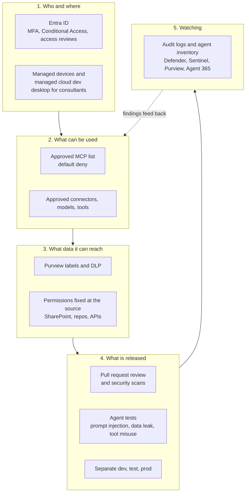
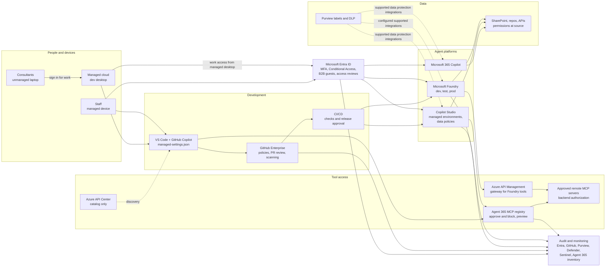
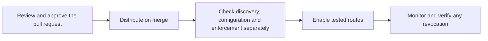
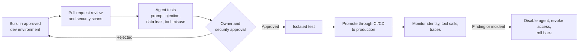
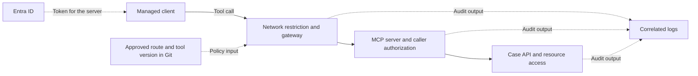

# Governing AI agents and MCP servers on the Microsoft stack

**Recommendation for:** Microsoft E7 tenant using Foundry, Copilot Studio, Microsoft 365 Copilot, GitHub Copilot, GitHub and VS Code, with managed devices and external consultants on unmanaged devices.
**Facts checked against Microsoft, GitHub and VS Code documentation on:** 2026-11-05 (statement review, including summaries and diagrams)

**How to read the tags**

| Tag | Meaning |
|---|---|
| **[verified]** | Read on the vendor page on 2026-11-05. |
| **[recommendation]** | Our design choice. Not a vendor claim. |
| **[inference]** | Reasonable conclusion. The vendor does not say it. |
| **[unverified]** | Not established by the sources reviewed. Do not assume this behavior in production. |

---

# Part 1. Summary

## The answer in one minute

**Pilot decision [recommendation].** Start with one internal, read-only case search and non-sensitive test data. Name an owner, agree the pass criteria in Part 4 and expand only after critical tests pass for the routes you will allow.

1. **One rule set, enforced in each product's own control panel.** Do not assume that Agent 365 inventory or registration enforces every runtime or connection path. Facts: 2.4, Part 5.
2. **Default deny for MCP servers.** Require approved servers on supported paths. Account for built-in server exemptions, custom agent profiles and clients without allowlist support (see 2.3). Facts: 2.3, 2.4.
3. **Keep source code and sensitive data on managed devices.** Consultants on unmanaged laptops work inside a managed cloud desktop (Dev Box, Windows 365 or Azure Virtual Desktop). Facts: 2.2.
4. **Agents get their own identity and the smallest possible access.** Read-only by default. Apply the action policy in 2.4. A human approves high-impact actions. A rules service can approve explicitly approved low-risk actions within their defined limits.
5. **Run it as policy as code.** The approved lists live in Git. Require an approved pull request and successful deployment of the resulting policies. This can reduce repetitive admin work. Facts: 2.8, Part 3.

All five points describe the proposed design.

## Case search from a consultant desktop

This is a fictional pilot. The consultant uses a managed cloud desktop. The model proposes a tool call, and the agent runtime sends it using Model Context Protocol (MCP). The server and case API check access before returning the test cases.

One result contains an instruction to send the cases to an external address. Treat the result as data, deny the outbound action and record the caller and decision with sensitive input masked. Follow the same example in 6.2 and the pilot checks in Part 4.

# Part 1, continued. Background for the answer

## The big picture



## Which tool does which job

| Job | Main tool | One-line reason |
|---|---|---|
| Who can sign in, from what device | Entra Conditional Access, Intune | Already in E7. |
| Consultant access | Entra B2B guests, access packages with expiry and reviews | Configured expiry removes access granted through the package. **[verified]** |
| Safe workplace for unmanaged consultants | Dev Box, Windows 365 or Azure Virtual Desktop | Keep working copies there and restrict transfer paths. **[recommendation]** |
| Allowed MCP servers in VS Code and GitHub Copilot | GitHub `managed-settings.json` allowlist | GitHub's recommended method, generally available. **[verified]** |
| Approve and emergency-block remote MCP servers | Agent 365 MCP registry (Microsoft 365 admin center, Agents, Tools) | Blocks registered server invocations through the gateway. BYO MCP is preview. **[verified]** |
| Catalog of internal MCP servers | Azure API Center | Catalog and discovery; do not rely on registration to prevent direct connections. **[recommendation]** |
| Copilot Studio guardrails | Power Platform managed environments, environment groups, data policies | Blocks connectors, channels, unauthenticated agents. **[verified]** |
| Foundry guardrails | Entra RBAC, agent identity, network isolation, Azure Policy for models and tools, API Management | Feed the Git-approved endpoints to the preview tool policy and use Deny to reject noncompliant tool configurations. This governs configuration requests; it is not a runtime gateway. **[recommendation]** |
| Data protection | Purview sensitivity labels, DLP for Copilot, SharePoint Advanced Management | Limits what Copilot can use. **[verified]** |
| Agent inventory and monitoring | Agent 365, Defender, Sentinel | Shows who runs what. **[verified, see platform list in 2.9]** |

## What E7 gives you

Microsoft's licensing page says: E7 includes everything in E5 and adds Microsoft Copilot, the Microsoft Entra Suite and Microsoft Agent 365 in a single license. **[verified, checked 2026-11-05]**

Agent 365 became generally available on 1 May 2026 for the Commercial segment. It is licensed per user. Microsoft says it "works best when using Microsoft E5 as a pre-requisite". It is also sold stand-alone.

For GCC, Microsoft announced purchasing from 1 October 2026 for Agent 365 and Microsoft 365 G7, with additional options from 1 November. Features arrive in phases as GCC authorization milestones are met. **[verified]** This announcement does not establish availability in GCC High or DoD.

Agent running costs are **not** fully in the license. Copilot Studio usage is metered in Copilot Credits. **[verified]**

Qualifying agent usage by Microsoft 365 Copilot licensed users, under their authenticated identity, incurs no additional Copilot Credits charge in the documented channels. Fair-use limits apply. Autonomous runs and computer-using agents are excluded. Agent flows qualify only with the "When an agent calls the flow" trigger. **[verified, billing rates checked 2026-11-05]**

Foundry model deployments can be billed per token (Global Standard is "Pay-per-token"). Hosted agents in Foundry Agent Service are billed on CPU and memory used across active sessions. **[verified, checked 2026-11-05]** Foundry's agent overview lists other possible charges, such as Application Insights and voice features. **[verified]**

Microsoft's Azure pricing page for Foundry Agent Service says there is no extra charge for creating or running Foundry-native agents built with prompts and workflows. You pay for model tokens, and separately for tools and knowledge connections. Hosted agents are billed on container compute per hour. **[verified, page read 2026-11-05, undated]**

Microsoft announced E7 general availability on 1 May 2026 and Agent 365 standalone at $15 per user per month. On 2026-11-05, the US E7 page lists $99 with Teams and $90.45 without Teams, per user per month, paid yearly with an annual commitment. Contract prices may differ. **[verified]**

## Four things that will surprise people

| Surprise | What it means for you |
|---|---|
| Agent 365 **BYO MCP governance is in preview**. | Use it as the emergency brake and approval record. Do not make it your only control. **[verified]** |
| BYO MCP preview supports **only** Copilot Studio, VS Code, Claude Code and GitHub Copilot CLI. **Foundry and Microsoft 365 declarative agents are not supported.** | Foundry needs its own controls. **[verified]** |
| Microsoft describes the registry and gateway for **remote** MCP servers. Local servers (run on the laptop with `stdio`) are not described as covered. | Control local servers with the GitHub command allowlist instead. **[inference for the gateway; verified for GitHub below]** |
| GitHub's allow and deny keys **do not apply** to MCP servers defined in repository custom agent profiles. | GitHub's advice: keep the domains needed to start them blocked in the organization or repository custom firewall for Copilot in the cloud. **[verified]** |

---

# Part 2. How to build it

## 2.1 Technical target state

Proposed architecture **[recommendation]**. Staff use a managed device. Consultants sign in from their laptop to a managed cloud desktop, then access code and tools from there. Verify each permitted route and block bypass paths. See 2.4 for route coverage, 2.6 for the Foundry gateway and 2.7 for Purview.



## 2.2 Identity and devices

**Goal:** the right person, on the right device, for a limited time.

The effort column gives planning estimates **[recommendation]**, not a guarantee of unattended operation. Monitor policies and review exceptions after setup.

| Step | How | Admin effort after setup |
|---|---|---|
| Require MFA for human users | Conditional Access, with tested emergency access exclusions **[recommendation]** | Monitor sign-ins and maintain recovery access |
| Phishing-resistant MFA for admins | Built-in authentication strength "Phishing-resistant MFA" (Windows Hello for Business or platform credential, FIDO2, multifactor certificate-based authentication). Needs Entra ID P1. **[verified; using it for admins is a recommendation]** | None |
| Consultants as B2B guests | Configure package expiry. Unextended assignments lose package-granted access. By default, guests invited through entitlement management are blocked after their last assignment ends and removed 30 days later. Existing guests need separate lifecycle configuration. License requirements depend on the features used; P2 covers basic capabilities, while Governance or Entra Suite covers advanced capabilities. **[verified]** | Approver clicks once |
| Review access | Access reviews on the package. Review quarterly **[recommendation]**. Set "if reviewers don't respond" to "Remove access". The option exists. **[verified]** To apply denials without admin work, tick "Auto apply results to resource". Nonresponse can then remove the access under review. **[verified, checked 2026-11-05]** | Owner answers a short list |
| Guest MFA from the consultant's own company | Conditional Access can require MFA for guests. Cross-tenant trust can accept the home tenant's MFA claims. Without trust, B2B collaboration guests are challenged in your tenant. **[verified]** | Set once |
| Guest limits to know | Strength policies apply only to guests who sign in with Entra ID. For email one-time passcode, SAML or WS-Fed, Google federation or personal Microsoft account guests, Microsoft says to use the MFA grant control. External authentication methods are incompatible with authentication strength. **[verified, 2026-03-24]** "Require approved client app" and "Require app protection policy" are not supported for guests. **[verified]** | None |
| Managed devices must be compliant | Intune compliance plus Conditional Access grant control **[verified]** | None |
| Unmanaged consultants | Cloud dev desktop (Dev Box, Windows 365 or Azure Virtual Desktop). **[recommendation]** | One image to maintain |
| Restrict desktop redirection | Intune Settings catalog: "Do not allow Clipboard redirection", "Do not allow drive redirection", "Do not allow client printer redirection". Newly provisioned and reprovisioned Windows 365 Cloud PCs have clipboard redirection off by default. Dev Box has it on, in both directions. **[verified]** Set the policy explicitly for Dev Box. | One policy |
| Unmanaged access to SharePoint and OneDrive without a dev desktop | "Allow limited, web-only access" in SharePoint admin center. Browser only, no download, print or sync, and no Office desktop apps. Built on Conditional Access. Microsoft's Zero Trust page says it needs Entra ID P1 or P2. **[verified]** | None |
| Unmanaged access to other apps | Defender for Cloud Apps session policies can block downloads, print and copy to clipboard. **[verified]** Session controls apply only to browser sessions. Microsoft says to block native clients with an access policy, using the Client app filter "Mobile and desktop". **[verified]** | Policy per app, plus a block rule for native apps |
| Agent identities | Conditional Access for agents. Three patterns: on-behalf-of, application-only, agent-user. **Start in report-only mode.** Microsoft says to do so. Needs E7, or Agent 365 plus Entra ID P1 or M365 E3. **[verified]** | Review report monthly |

**Limits:**

- Redirection controls reduce transfer paths. Do not treat them as proof that data cannot leave an unmanaged viewing device. **[inference]**

The following identity limits are **[verified]**:

- Conditional Access does not apply to API-key access. Remove API keys where you can.
- The Users assignment does not apply to agent user accounts. Use the separate Agents target.
- The "Agent risk" and "Agent execution environments" conditions are labeled **preview**. Check the availability of each condition before rollout. **[recommendation]**
- Guests: using Entra ID Governance features for guests needs a tenant linked to an Azure subscription with the "Microsoft Entra ID Governance for guests" add-on. Microsoft says this was enforced from January 2026.
  - Guests are billed only when they use features exclusive to Entra ID Governance.
  - Entra P2 features, including basic access reviews and entitlement management, are not billed. The subscription link is not required for them.
  - At least one admin needs an Entra ID Governance or Entra Suite license.
  - **[verified, guest licensing checked 2026-11-05]**

## 2.3 VS Code, GitHub and GitHub Copilot

**Goal:** developers can use AI help, only with approved tools, only with company accounts.

1. **Company accounts only.** Use the documented account and network controls below. Their effectiveness depends on the account, client and enforced network path:
   - Managed user accounts (Enterprise Managed Users) cannot sign up for Copilot Pro or Free. They need a Copilot Business or Enterprise seat. **[verified]**
   - **Subscription-based network routing** (GitHub.com only): allow your plan's endpoint on the firewall and block the personal-plan endpoint. It covers inline suggestions and chat in VS Code, Visual Studio and JetBrains, Copilot Chat on GitHub, GitHub Mobile and the CLI. It is not supported on GHE.com. Members need minimum client versions. **[verified]**
     We did not test it. Test it from a consultant path before you rely on it. **[recommendation]**
   - For Enterprise Managed Users, "Enterprise access restrictions" can reject non-enterprise accounts on supported endpoints through an inspecting proxy that injects the enterprise header. The enterprise owner must enable it. SSH and other unsupported paths need separate restrictions. **[verified]**
2. **Create one policy repo.** GitHub documents storing the file in a `.github-private` repository owned by a designated organization. The path is `copilot/managed-settings.json`. GitHub recommends internal visibility and limiting edits to administrators and AI managers. **[verified]**
   - Settings reach all users who get a Copilot license from your enterprise, on a supported client, within about an hour.
   - Two other ways exist. MDM sets each key as a string value (Windows registry `HKLM\SOFTWARE\Policies\GitHubCopilot`, or the macOS `com.github.copilot` domain). Clients check hourly. Linux has no MDM path. **[verified]**
   - The file-based way copies `managed-settings.json` to a fixed folder per operating system, and the client reads it at startup. **[verified]**
   - Copilot CLI on macOS and Linux requires the local policy file to be a regular root-owned file, not a symbolic link, with no group or world write permission. **[verified]**
   - For ordinary keys, precedence is MDM, server-managed, file-based, then user settings. MCP allowlists intersect and denylists combine across sources, rather than simply replacing lower-priority values. **[verified]**
3. **Allow by URL or command.** Each entry must contain exactly one of `serverName`, `serverUrl` or `serverCommand`. **[verified]**
   - `serverName` matches the user-assigned label exactly and case-sensitively. No wildcards. Users choose labels, so use URL or command matching to enforce server identity. **[verified]**
   - `serverUrl` accepts `*` wildcards. It applies to remote servers only.
   - `serverCommand` is a list. It must match the command and every argument, in order. It applies to local servers only.
4. **How GitHub decides [verified]:**
   1. Built-in default servers, such as the built-in GitHub MCP server, are always allowed and cannot be blocked by deny rules.
   2. A match in `deniedMcpServers` blocks the server. Deny wins over allow.
   3. If `allowedMcpServers` exists, anything not matched is blocked. If the key is omitted, all servers are allowed unless denied. An empty list blocks everything except built-in servers.
   4. A URL or command with an unresolved `${VARIABLE}` is blocked.
   5. With several sources, a server must match an allow entry at every layer that defines one (intersection of allowlists). A deny rule from any source blocks it (union of denylists).
5. **Malformed MCP policy fails closed.** A malformed allowlist or denylist is treated as an empty allowlist. Everything except built-in default servers is blocked. **[verified]**
   - If a client cannot determine a policy layer because of a retrieval error, it keeps the previously enforced policy. That can become stricter but not looser. **[verified]**
   - In Copilot CLI, if the request fails and no cached response exists, the server-managed policy is unavailable for that session. For limits that must always hold, GitHub advises MDM or file-based delivery. **[verified]**
   - The setting `forceRemoteSettingsRefresh: true` requires a fresh download at startup in Copilot CLI, VS Code and the Copilot app. In the CLI and the app it skips the one-hour cache and blocks fallback to an older policy. In VS Code, Copilot features stay blocked until the download succeeds. Users need a network connection at start. **[verified]**
   - To apply it from the first startup, deliver this key by MDM or file, not server-managed. Policy helper scripts cannot set it. **[verified]**
   - For the GitHub MCP registry policy in VS Code (1.145 and later): if no policy is cached and the first fetch fails, the registry policy alone does not restrict MCP access. The ChatMCP device policy covers that case (VS Code page, checked 2026-11-05). **[verified]**
   - First-start behavior without a cached server-managed policy and with this key off is not established here for other clients. **[unverified]** Deliver mandatory restrictions locally and test startup with the network unavailable. **[recommendation]**
6. **Add VS Code device policies** on managed devices (Group Policy, Intune, macOS profiles; Linux uses `/etc/vscode/policy.json` from VS Code 1.106). **[verified]** Policies named on the VS Code page:
   - `ChatAllowedMcpServers`, `ChatDeniedMcpServers`, `ChatAllowManagedMcpServersOnly`
   - `ChatMCP` (setting `chat.mcp.access`, "Controls access to installed Model Context Protocol servers")
   - `ChatAgentMode` (setting `chat.agent.enabled`)
   - `ChatCopilotConnectors`, `AllowedExtensions`

   If a Copilot managed setting and a device policy cover the same control, the Copilot setting wins. The values are not merged. **[verified]**
   Configure each control in one place. **[recommendation]**
7. **Check the result** with **Developer: Policy Diagnostics**. It shows the effective value and its source. **[verified]** Windows device policy applies at the next VS Code start; some policies also require restarting Windows. **[verified]**
8. **Switch off what you do not need:** agent mode, unapproved extensions, connectors. **[recommendation]**

Illustrative file using GitHub's documented matcher shape. The URL is a placeholder; the package commands are real examples, not approved deployments. **[verified shape; entries are examples]**

For deployment, review and pin local packages and protect their installation paths. Exact command matching does not establish the integrity or safety of the executable it starts. **[recommendation]**

```json
{
  "allowedMcpServers": [
    { "serverUrl": "https://mcp.example.corp/docs/*" },
    { "serverCommand": ["npx", "@playwright/mcp@latest"] }
  ],
  "deniedMcpServers": [
    { "serverCommand": ["npx", "-y", "@modelcontextprotocol/server-filesystem", "/"] }
  ]
}
```

An allowlist blocks unmatched servers within its supported scope, apart from built-in exemptions. Use deny rules to revoke individual matches, including matches under a broader allow entry. **[recommendation]**

**Which clients obey the file.** GitHub's client table has these columns: Copilot CLI, VS Code, the GitHub Copilot app, Copilot in the cloud (sandbox), Copilot in the cloud (GitHub Actions), JetBrains IDEs. 

For both MCP keys, the table marks every column as supported except Copilot in the cloud (GitHub Actions). **[verified: table cells read in the page on 2026-11-05]**

**Approval workflow [recommendation]:** require pull request review, a recorded reason and protected default-branch updates. Git alone does not require review. Merging the file also does not prove that every client has received the policy.

**Registry policy.** GitHub also has a custom MCP registry policy (Allow all, or Registry only). It works with Azure API Center, using the base URL without `/v0.1/servers`. GitHub marks it **public preview, "not prioritized for development"**, and "not the recommended method". **[verified]**

Matching uses name or ID only, and users can bypass it by editing config files. GitHub advises setting it to Allow all when you use the allowlist. Do not use it as the main control. **[verified]**

**Unmanaged consultant laptops.** Do not assume device policy delivery to an unenrolled consultant laptop. **[recommendation]** Server-managed settings follow the signed-in account and apply only to users who get a Copilot license from your enterprise. **[verified]**

A supported client receives server-managed settings for the consultant's enterprise-licensed signed-in account. Switching to a separately licensed personal account does not carry those account-based settings over. A personal Copilot plan can be blocked on your network by the firewall control above.

We did not test it. Test it from the consultant path before you rely on it. **[recommendation]** Use a managed cloud desktop with tested network and transfer controls. **[recommendation]**

**If VS Code is managed by Intune [recommendation]:** Intune adds a second way to reach VS Code. It does not reach the other products that the approved list is published to in 2.4 (Agent 365, Foundry and Azure API Center). Nothing here was tested in a real tenant.

- **What it can set.** The VS Code device policies `ChatAllowedMcpServers`, `ChatDeniedMcpServers`, `ChatAllowManagedMcpServersOnly`, `ChatMCP`, `ChatAgentMode`, `ChatCopilotConnectors` and `AllowedExtensions`. **[verified]**
- **GitHub MDM keys.** Windows registry `HKLM\SOFTWARE\Policies\GitHubCopilot` and macOS domain `com.github.copilot`. Clients check hourly. Linux has no MDM path. **[verified]**
- **Why use it.** GitHub advises MDM or file delivery for limits that must always hold. It does not depend on a settings download at first start. **[verified]**
- **Keep one source of truth.** If Intune sets the GitHub MDM key `allowedMcpServers`, the effective list is the intersection with the Git list. A server must be permitted by every source, so a server missing from either list is blocked. **[verified]** Keep the Git list as the master. **[recommendation]**
- **One place per control.** If a Copilot managed setting and a VS Code device policy cover the same control, the Copilot setting wins. The two are not merged. **[verified]** The pages we read do not pair each device policy with its Copilot key, so check each pair in Policy Diagnostics. **[inference]**
- **Check it.** Run **Developer: Policy Diagnostics** to see the effective value and its source. Windows device policy applies at the next VS Code start, and some policies also need a Windows restart. **[verified]**
- **What it does not cover.** Unmanaged consultant laptops (use a managed cloud desktop), and the Agent 365, Foundry and API Center paths in 2.4. No source describes an automatic Git to Intune path. Making it automatic would be your own build and was not researched. **[unverified]**

## 2.4 Governing which MCP servers are allowed

Use Git as the source of truth and publish the approved list automatically. Record the policy version and delivery result for each destination. Confirm enforcement independently. For removal, withdraw the approved configuration and revoke runtime access where needed. **[recommendation]**



**Risk tiers [recommendation].** Apply the highest applicable tier. Assess who operates the server separately from whether the endpoint is public.

| Tier | Example | Publication and action approval |
|---|---|---|
| 1. Read-only, internal, no sensitive data | Internal case search | Automate checklist checks. Record approval in the pull request. |
| 2. Read-only, sensitive data | HR or finance reads | Security and the data owner approve publication. |
| 3. Can change data or call out | Create tickets, send mail, deploy | Security and the data owner approve publication. Apply the action policy at run time. |
| 4. Third-party operated or untrusted code | Community MCP servers | Default deny. A recorded exception must still meet the action policy. |

**Action policy [recommendation].**

- Before publication, review the endpoint, tool version, schema, data and permissions. Require the applicable tier approvals.
- For each call, check that the caller may use the server, tool and resource. Apply access checks independently of the model.
- For a write or outbound action, require an authorized request or approved trigger. Require a human for high-impact actions and actions outside an approved rule. A rules service can approve explicitly approved low-risk actions bounded by tool, permitted inputs, target and data. Deny when the required approval is absent.
- Use a separate, narrowly scoped identity for execution. Record the approval and outcome.

**Server checklist (copy into the pull request template):** named owner, purpose, publisher and source, authentication type, data it can read, actions it can take, logging available, how to disable it, review date.

| Client and route | Discovery | Setup and configuration | At call time | Pilot check |
|---|---|---|---|---|
| VS Code and GitHub Copilot | See API Center. | Publish `managed-settings.json` for supported clients. | Check exemptions for built-ins, custom agent profiles and Copilot cloud on GitHub Actions. | Test the enterprise account, client version, delivery and personal account paths. |
| Agent 365 Tools Gateway via API Management | Preview discovery from connected API Management. | Connect the gateway, grant tenant consent and confirm per-server allow or block. | Verify the effect on calls using this route and test direct routes separately. | Test initial state, refresh delay and allow or block behavior. |
| Agent 365 BYO MCP | Review submitted requests. | Approve requests and grant consent. | Whole-server blocking on supported registered gateway routes **[verified, preview]**. | Check client coverage, gateway blocking and backend revocation. |
| Copilot Studio via connectors | Inventory agent connections. | Apply Power Platform data policies. | The policy can block tools that rely on blocked connectors **[verified]**. | Test each connector and the paths outside it. |
| Foundry agent tools | Inventory tools and endpoints. | Assign preview Azure Policy with Deny for noncompliant create or update requests **[verified]**. | Use a separate runtime or backend control for existing agents. | Test configuration denial and runtime revocation separately. |
| Local MCP via `stdio` | Inventory local commands and arguments. | Use GitHub's command allowlist where supported. | Local calls fall outside Global Secure Access MCP logging (E12). | Test allowed and denied commands on each client. |
| Direct API or data access | Inventory direct connections. | Restrict endpoints and scope each identity. | Check resource permissions at the source. | Retry after revocation. |
| Azure API Center catalog | Sync the connected API Management inventory **[verified]**. | Publish catalog entries for discovery. | Set up a separate enforcement control for direct connections. | Verify denial at the intended boundary. |

**Publication details.**

- **VS Code and GitHub Copilot.** Merging `copilot/managed-settings.json` in `.github-private` publishes to supported enterprise-licensed clients within about an hour. **[verified]** Use MDM or file delivery for controls that must hold across account changes. See 2.3.
- **Agent 365 Tools Gateway.** Register approved servers in API Management from the pipeline. The service documents REST API, ARM, Bicep, Azure CLI and Terraform for registration. The preview gateway discovers registered servers after tenant consent and on subsequent refreshes. Administrators can apply per-server allow or block. **[verified]** Automatic policy application and the initial server state remain unverified.
- **Foundry.** Have the pipeline write the Git-approved endpoints into the preview tool policy assignment. Azure Policy supports CLI, PowerShell and REST assignment. **[verified]** Test the proposed pipeline and the intended Deny scope. Use a separate runtime or backend control. See 2.6.
- **Azure API Center.** The linked API Management inventory syncs MCP entries. **[verified]** Treat the catalog as discovery. Whether a Foundry catalog integration enforces an allowlist was not checked.

**Agent 365 BYO MCP registry facts [verified 2026-11-05]:**
- Path: Microsoft 365 admin center, **Agents, Tools**. Requests appear under **Requests (preview)**. Registry is under Agents, Tools, Registry.
- Roles: AI Administrator or Global Administrator.
- Flow: approve the request, then grant Entra consent. Gateway use requires that approval and consent flow.
- Block or unblock a whole server. Blocking also disables its tools and dependent plugins.
- Tool-level on/off is rolling out for supported server types. For bring-your-own servers it is "planned for a future release".
- The server needs a **publicly accessible endpoint**. Developers need Agent 365 CLI 1.1.165-preview or later and the Agent 365 service principal in your tenant.
- Allowed authentication: NoAuth, API key (header or query), external OAuth, Entra OAuth. Prefer Entra OAuth and avoid NoAuth. **[recommendation]**
- New versions of a registered server cannot be republished during preview.
- Gateway calls can be found in Defender advanced hunting: `CloudAppEvents | where ActionType in ("ExecuteToolByGateway")`. The bring-your-own MCP page gives this sample query.

## 2.5 Copilot Studio

- **Separate environments** for development, test and production, with a gated release to production. **[recommendation; Microsoft's zoned governance page uses zones]**
- **Tenant data policies** can allow or block: unauthenticated usage, individual channels, knowledge sources, individual connectors, Azure Bot Service skills, and Application Insights integration. Tenant policy can also allow or block publishing of agents that use generative AI. **[verified, checked 2026-11-05]**
- **Require authentication:** block the connector "Chat without Microsoft Entra ID authentication in Copilot Studio". Then makers cannot publish agents without authentication. **[verified]**
- **Maker credentials:** tools support end-user or maker-provided credentials; user authentication is the default. **[verified]** Require end-user credentials for shared agents that must preserve each user's access limits. Review credential configuration before release; the cited data-policy page does not establish a universal switch that bans maker credentials. **[recommendation]**
- **Environment groups** hold only managed environments. A published rule is enforced in every member environment and becomes read-only there. There are no per-environment exceptions. **[verified]**
  - Rules include: accessing conversation transcripts, generative AI settings, external models, knowledge sources, sharing agents with Editor or Viewer permission, and Skills in Copilot Studio. **[verified]**
  - One group rule set covers many environments, which keeps admin work low. **[inference]**
- **MCP:** connector blocking covers MCP tools that rely on those connectors (see 2.4). **[verified]** For other paths, require approved connections, restrict maker privileges and test both direct and gateway calls. Agent 365 registration alone does not prove default-deny enforcement. Nothing was tested in a tenant. **[recommendation]**
- Advanced connector policies in the Power Platform admin center are for the stricter zones. **[verified]**

## 2.6 Microsoft Foundry

All points below were read on Microsoft Learn on 2026-11-05 unless tagged otherwise.

- **Separate projects** for dev, test and production. Microsoft's planning page treats this as guidance, with a prod policy that "defaults to isolation". **[verified as guidance, not a setting]**
- **Entra RBAC.** Roles include Foundry Agent Consumer, Foundry User, Foundry Project Manager, Foundry Account Owner and Foundry Owner. Microsoft says to prefer Entra ID and RBAC and use API keys only where role granularity is not needed. A key grants access to its resource without RBAC role restrictions. **[verified]**
- **Agent identity.** The current model provisions a unique blueprint and default-instance identity; legacy agents can retain a shared project identity. On-behalf-of agent identity is **preview**. **[verified]** Name an owner and sponsor for every agent. **[recommendation]**
- **Network isolation.** Inbound: disable public access and use a private endpoint. Outbound: use supported VNet injection or managed networking. Managed modes allow internet outbound, allow only approved outbound, or disable managed isolation. Once enabled, managed isolation cannot be disabled; approved-only cannot revert to internet outbound. The CLI group is preview. **[verified]**
- **Approved models by policy.** Built-in Azure Policy definitions "Foundry model deployments should only use approved models" and "...should meet eligibility requirements" are generally available. **[verified]**
- **Approved tools by policy.** Two **preview** built-in definitions: "Microsoft Foundry agents and toolboxes should only use approved tools" and "...should not use denied tools". They cover tool types, MCP endpoints and MCP connectors. Effects: Audit, Deny, Disabled. **[verified, policy index checked 2026-11-05]**
- **Feed the approved MCP endpoints from Git into Azure Policy.** For endpoint-level default deny, keep `mcp` out of `approvedToolTypes`; the policy treats any approved tool type as allowed independently of its endpoint. Its Deny effect rejects noncompliant create or update requests. **[verified, policy definition checked 2026-11-05]**
- **Handle existing agents and runtime separately.** Azure Policy compliance can identify existing noncompliant configurations, but Deny does not itself remove their tools or establish that invocation is blocked. Remove or update affected tools, then test existing and new agents. For runtime enforcement, mediate calls through a supported gateway or revoke backend access and close direct paths. **[recommendation; runtime behavior not tested]**
- **Secrets:** use managed identity and Key Vault, and never put keys in code. **[recommendation]**
- **Turn off keys.** Assign the built-in policy "Azure AI Services resources should have key access disabled (disable local authentication)" at subscription or resource group level, or set `disableLocalAuth` to true in the template. The change can take up to several hours to apply. Verify key-based requests fail before treating authentication as disabled. **[verified, checked 2026-11-05]**
- **Remote tools through API Management.** The Foundry AI gateway is **preview**. It routes only new MCP tools created in the Foundry portal that do not use managed OAuth. It does not support SharePoint, code-first MCP tools, managed OAuth tools or OpenAPI tools. It does not log tool traces.
  - Routing is applied only when the tool is created, so existing tools are not covered.
  - The documented workflow applies API Management policies in the Azure portal; the Foundry portal does not expose this step.
  - **Verify routing for each tool.** **[verified, checked 2026-11-05]**
- Protect traces and logs as sensitive data. They can contain prompts and customer content. **[recommendation]**

## 2.7 Microsoft 365 Copilot and your data

Copilot works within existing permissions. Microsoft says it "only accesses data that users are authorized to access". **[verified]** Treat oversharing as one risk alongside prompt injection and tool misuse; existing user permissions do not establish that an agent's actions are safe. **[recommendation]**

1. **Find and fix oversharing.** SharePoint Advanced Management is included when at least one user has a Copilot license (true in E7). Some features, such as restricted site creation, need the SharePoint Advanced Management Plan 1 add-on. **[verified]** Restricted Content Discovery limits organization-wide discovery; it leaves permissions and direct access intact. **[verified]**
2. **Use Data Security Posture Management (DSPM).** It offers default and custom data risk assessments to find and fix oversharing. **[verified, checked 2026-11-05]** The default assessment runs weekly for the top 100 SharePoint sites by usage, and for the top 100 Fabric workspaces once Fabric is set up. **[verified]**
   The cited 2025-12-15 licensing page describes **classic DSPM**, while the assessment page describes current DSPM. Do not use the classic page alone to establish current assessment entitlement. Check the current Purview service description and applicable feature licensing before rollout. **[recommendation]**
3. **Apply sensitivity labels** and use DLP for Copilot. DLP can block external web search for prompts containing configured sensitive information types and exclude files or emails with selected labels from processing. Sensitive-prompt blocking is **preview**, with tenant rollout to verify. DLP cannot scan files uploaded directly into prompts. Label-based exclusions may still leave items in citations. **[verified]**
4. **Verify auditing is enabled.** Copilot audit records identify interactions, message IDs and accessed resources. Do not assume the audit event contains full prompt or response text. **[verified for documented fields; recommendation for investigation planning]**

## 2.8 Safe release path for agents



All of this is **[recommendation]**.

**Rules for agents that act:**
- The agent never holds direct high-impact write access.
- Apply the action policy in 2.4 for every write or outbound request. A **separate, narrowly scoped identity** executes approved actions.
- Permissions are checked at the data source and the API, never only in the prompt.
- No secrets in prompts, source code or traces.

## 2.9 Monitoring and inventory

**Operations runbook [recommendation].** Find the affected calls and identify the caller, route, tool and decision. Disable the agent and block the affected client or gateway route. Revoke at the source and update Git. Retry from an existing agent and alternate routes, then correlate denial events before restoring access.

| Need | Source |
|---|---|
| Who is signing in, from where | Entra sign-in logs |
| Code and Copilot policy events | GitHub audit log. GitHub can stream it to Amazon S3, Azure Blob Storage, Azure Event Hubs, Datadog, Google Cloud Storage, Splunk and Microsoft Purview. Purview streaming is public preview, limited to Copilot agent session events, and available for Enterprise Managed Users or GitHub Enterprise Cloud with data residency. **[verified]** |
| GitHub audit log in Sentinel, connector 1 | Uses the Codeless Connector Framework. Needs an Enterprise admin and a classic personal access token with `read:audit_log`. Works only with GitHub Enterprise Cloud (table `GitHubAuditLogsV2_CL`). **[verified]** |
| GitHub audit log in Sentinel, connector 2 | Reads from Azure Blob Storage on an Azure Data Lake Storage Gen2 account (table `GitHubAuditLogsV3_CL`). Needs Entra admin consent. Not supported in Azure Government. Microsoft recommends it over connector 1 above about 10,000 events per 15 minutes. **[verified]** |
| Sentinel connector status | Source: Microsoft's connector reference introduction and GitHub entries, checked 2026-11-05. The page says Sentinel data connectors are currently in preview, with no per-connector marking for these two. **[verified]** |
| Agent inventory and activity | Agent 365 and the Microsoft 365 admin center. Named platforms: Copilot Studio, SharePoint, Agent Builder, AI Foundry, Agents Toolkit. Connected platforms use manual synchronization: Amazon Bedrock, Google Vertex AI, Salesforce Agentforce, Databricks Genie, Claude Managed Agents, Oracle Generative AI Agents and Snowflake Cortex Agents. **[verified]** Add each product's own inventory. |
| Third-party activity coverage | Connected-platform observability is a Frontier preview. Oracle and Snowflake observability are listed as coming soon; registry synchronization does not supply code-level SDK capabilities. **[verified, checked 2026-11-05]** |
| MCP tool calls through the gateway | Defender advanced hunting (see 2.4) |
| Data protection and investigation | Purview DLP for supported scenarios; audit metadata and separately authorized content investigation. Verify coverage per workload. **[recommendation]** |
| Alerts | Sentinel rules for: blocked MCP attempts, new agent created, new connector added, agent used by a guest **[recommendation]** |

---

# Part 3. Keeping admin work low

All rows are **[recommendation]**. The vendor features they rely on are tagged in Part 2.

| Principle | In practice |
|---|---|
| Policy as code | MCP allowlist and Copilot settings in Git. Require reviewed pull requests and confirm deployed policy versions. |
| Groups, not people | Access by Entra group tied to project. Use group-backed permissions where supported; verify provisioning, removal and direct grants. |
| Time limits by default | Consultant access, privileged roles and MCP exceptions all expire. Configure expiry and a documented renewal workflow for each system. |
| Automate tier 1 checks | Tier 1 may use automated pull request approval after the checklist passes. Require named approvers for higher tiers. |
| Report-only first | Run new Conditional Access rules in report-only mode, then enforce. Microsoft recommends this for agent policies. |
| Environment groups | One rule set for many Power Platform environments. |
| One owner per agent | Owner gets a quarterly "keep or retire" list. Unowned agents are disabled after 30 days. |
| Use Microsoft defaults | Prefer built-in templates, managed environments and Agent 365 views over custom tooling. |
| One report, not ten | A single monthly review pack: new agents, new MCP servers, blocked attempts, expiring access. |

---

# Part 4. Rollout plan

All rows are **[recommendation]**.

| When | Do this | Done when |
|---|---|---|
| Weeks 1 to 2 | Inventory: tenants, Foundry projects, Power Platform environments, VS Code AI extensions, MCP configs, external accounts. Name owners. | Every item has an owner. |
| Weeks 2 to 4 | Baseline: MFA, consultant access packages, report-only Conditional Access for agents, GitHub policy repo with an empty MCP allowlist (built-in servers remain exempt), Studio data policies and environment groups, separate Foundry environments, Dev Box clipboard and drive redirection set to off by policy. | Policies exist and report. |
| Weeks 4 to 6 | Pilot one low-risk read-only agent. Try it from a managed device and from the consultant cloud desktop. Test that an unapproved tool configuration is rejected in VS Code, Copilot Studio and Foundry. Separately test existing-agent invocation and backend revocation. Test a personal Copilot account on your network. | All critical pilot checks pass for the routes proposed for production. |
| Weeks 6 to 10 | Enforce. Add the pull request template, risk tiers and monthly review pack. Turn on Sentinel alerts. | The rollout owner approves the evidence, and operations verifies enforcement and the rollback path. |
| Ongoing | Re-check the preview items monthly (Agent 365 registry, Foundry gateway, GitHub client coverage, tool-level blocking). | Gaps closed or accepted in writing. |

### Read-only pilot pass criteria

Assign a named owner to each role. Keep the result, client and version, identity, policy version and evidence link in the pilot record.

| Check | Test owner | Pass when and evidence |
|---|---|---|
| Allowed read and device boundary | Identity and endpoint owners | The approved case search works from managed staff devices and the consultant desktop. Protected resources deny direct access from the unmanaged laptop and personal account. Attach client results and sign-in events. |
| Denied setup and unauthorized call | Platform owner | Disallowed setup is rejected where a configuration control is expected. Wrong-audience tokens and unauthorized tool or resource requests fail on the remote route. Attach the setup result and call decisions separately. |
| Untrusted results and action bounds | Agent owner and security | The embedded instruction causes no outbound transfer. In isolation, rules can only approve the expressly allowed low-risk action within its bounds. Attach the execution and decision trace. |
| Bypass paths | Network and client owners | Direct endpoint requests and disallowed local tools are blocked on in-scope routes. Record excluded routes. Attach network and client results. |
| Revocation and rollback | Operations and data owners | A previously working agent is denied after backend revocation. Approved read access returns after the documented rollback. Attach results and timestamps. |
| Audit trail | Security operations | Allowed and denied calls are traceable to caller, tool, decision and correlation ID. Attach redacted events. |

Go to production only after the rollout owner and security review passing evidence for all critical checks on every allowed route. Keep failed routes disabled and resolve open critical gaps.

---

# Part 5. Known gaps and what has not been tested

1. **Nothing here has been tested in your tenant.** Each place that says "test" is a step for your pilot, not a result.
2. **Agent 365 BYO MCP governance is preview.** Scope, licensing, behavior and supported clients can change. Confirm that your tenant has it and your client versions are supported. **[verified]**
3. **Foundry is not a supported Agent 365 BYO MCP preview client.** The shared Git-approved endpoint list can still govern Foundry tool configuration through its own Azure Policy, currently preview. Deny blocks noncompliant create or update requests; it does not remove existing tools or establish runtime blocking. **[verified; runtime behavior not tested]**
4. **Local MCP servers:** Microsoft does not describe the gateway as covering them. GitHub's command allowlist can, but needs exact commands. **[inference and verified]**
5. **Unmanaged consultant laptops:** server-managed settings follow the enterprise-licensed signed-in account. Device-delivered MDM or file policies can remain active across account switches, but their delivery and integrity must be established. **[verified]** Require a managed cloud desktop and tested network and transfer restrictions. **[recommendation]** How a personal account behaves on your network is for your pilot to test. **[recommendation]**
6. **GitHub client support for the MCP keys:** the cloud agent on GitHub Actions is not supported, and custom agent profiles are exempt. Plan another control for both. **[verified]**
7. **Personal Copilot access:** subscription-based routing needs firewall enforcement. Enterprise access restrictions additionally require Enterprise Managed Users, enterprise configuration and proxy header injection on supported endpoints. Validate unsupported paths separately. **[verified]**
8. **Guest governance licensing** is now confirmed on Microsoft's guest licensing page. The add-on applies to Governance-exclusive features only. Check which features your access packages use. **[verified]**
9. **Sentinel GitHub connectors** are on a page that says all Sentinel data connectors are in preview. Treat them as preview. **[verified]**
10. **Behavior still requiring validation:**
    - First start without a cached server-managed policy and with `forceRemoteSettingsRefresh` off is not established here for clients other than Copilot CLI. VS Code separately documents its registry-policy case (see 2.3). **[unverified]** Deliver mandatory restrictions locally and test failed fetches. **[recommendation]**

---

# Part 6. Technical guide for remote MCP

This guide covers a proposed remote MCP route. Use Part 2 for product settings and other agent controls. **Tenant tests pending.**

## 6.1 Introduce the controls in four phases

1. **Inventory.** Discover the routes in use and set up enough monitoring to verify the inventory.
2. **Review and record.** Register the proposed server and approve its tools before enabling use.
3. **Deploy controls.** Authenticate, authorize, broker and restrict the route.
4. **Prove and operate.** Run the pilot checks, monitor approved routes and repeat checks after changes.

## 6.2 One remote MCP call from a managed client

Proposed route for the case-search example. Confirm coverage before applying it to a client or runtime.



The proposed network layer uses the Global Secure Access MCP firewall (E1). Confirm client and inspection prerequisites (E10). Check local, hosted and direct routes separately in the route matrix and 6.6.

## 6.3 Steps for each control

Each step has a tag. The E numbers point to the exact quote in 6.7.

### 1. Discover

1. Turn on MCP logging in Global Secure Access. Microsoft says it helps find shadow MCP servers. **[verified, preview]** (E9, E8)
2. On devices, install the Global Secure Access client with internet traffic forwarding and TLS inspection on. **[verified]** (E10, E11)
3. Do not count local servers as seen. The log only captures traffic to remote servers. **[verified]** (E12)
4. Connect API Management to the Agent 365 Tools Gateway, so servers kept there are found. See 2.4. **[verified, preview]**
5. Compare what is found with the Git list. A server that is found and not listed is a finding to follow up. **[recommendation]**

### 2. Register

1. Keep one record per approved server in the Git list from 2.4. The fields are in 6.4. **[recommendation]**
2. Publish from Git on merge. Verify delivery and check enforcement independently. See 2.4 for administrator steps and gaps. **[recommendation]**
3. Give every record an expiry date. After it, the pipeline removes the server unless someone approves it again. **[recommendation]**
4. Treat the Git list as the source of truth. A spreadsheet copy is a second list to keep in sync. **[recommendation]**

### 3. Authenticate

1. Register each MCP server as its own Entra application, so its tokens name that application as the audience. **[recommendation]**
2. The server must check that a token was issued for it. The MCP specification requires this. **[verified]** (E22)
3. In API Management, the `validate-azure-ad-token` policy can check the audience. **[verified]** (E21)
4. Also check issuer and expiry. No page read for this part states these two checks. **[recommendation]**
5. Give the server's own access to backends a managed identity or workload identity. No long-lived secrets, no shared credentials. **[verified]** (E25)
6. Keep credentials out of source code and plain-text config files, such as an `mcp.json` file. Rotate them. **[verified]** (E26)
7. Secrets you cannot avoid go in Key Vault. **[verified]** (E27)
8. Do not approve servers with no authentication. Agent 365 accepts NoAuth, but 2.4 says to avoid it. **[recommendation]**

### 4. Authorize

1. Check three levels: may this client use this server, may this caller use this tool, may this caller touch this resource or take this action. **[recommendation]**
2. Do not make the server a "god mode" proxy. Keep its execution identity apart from the caller's rights, and check each caller. **[verified]** (E28)
3. Never pass a client's token on to a backend API. The specification forbids it. **[verified]** (E23)
4. A proxy server for a third-party API needs consent per client. **[verified]** (E24)
5. If the backend must see the user, exchange the user's token instead of using the server's own identity (on-behalf-of). No page on this was read. **[unverified]**
6. Keep the tool list small. Expose only the tools named in the record. **[recommendation]**

### 5. Broker

1. Put remote MCP servers behind API Management. It can secure inbound access, from client to gateway, and outbound access, from gateway to server. **[verified]** (E18)
2. Inbound: have it validate Microsoft Entra tokens. **[verified]** (E19)
3. Outbound: use its credential manager to add OAuth tokens to the backend calls that tools make. **[verified]** (E20)
4. Make the server accept calls only from the gateway, so the gateway cannot be skipped. **[recommendation]**
5. The network settings that enforce this were not checked. **[unverified]**

### 6. Restrict

1. Firewall: allow or deny MCP servers by URL pattern. **[verified, preview]** (E2, E1)
2. Per server, allow or block tools, resources and prompt templates. **[verified, preview]** (E3)
3. Start from default deny: default action Block, plus an allow list of approved servers. Keep a block-all rule ready for an incident. **[verified, preview]** (E6, E4)
4. The firewall needs an Entra Internet Access licence. **[verified]** (E5)
5. Do not build the whole model on the firewall. It sees only remote traffic from devices that run the client, and it is in preview. See 6.6. **[recommendation]**
6. Put each server in its own network segment. Reach backends over private endpoints, limit outbound traffic, and use one managed identity per server with least privilege. **[recommendation]**
7. No Microsoft page on private endpoints, network groups or outbound limits was read for this part. **[unverified]**
8. Run untrusted servers in an isolated environment with least privilege. The Azure MCP Server page says this about servers used beside it. **[verified]** (E29)
9. Aim for a small blast radius: a hijacked server reaches only what its record lists. **[recommendation]**

### 7. Approve

1. Approve the whole tool surface: tool names, descriptions, parameter schemas, endpoint and permissions. **[recommendation]**
2. Review tool descriptions as untrusted input. Microsoft describes how a malicious server can use descriptions to influence the agent's use of other servers. **[verified]** E30
3. Any change to those items needs a new pull request and a new review. **[recommendation]**
4. Use the action policy in 2.4. For a write or outbound tool, require human approval unless the action matches an explicitly approved low-risk rule. **[recommendation]**
5. Treat the tool result as data and check each proposed follow-up action independently. In the case-search example, deny the outbound request and record the decision. **[recommendation]**

### 8. Monitor

1. Read the Global Secure Access MCP log. It holds the user, the tool name and input arguments, and it matches each request to its response by event ID. **[verified, preview]** (E13, E15, E16, E8)
2. Check allow and block decisions in the Global Secure Access traffic logs. **[verified]** (E7)
3. Send the logs to the stack in 2.9. **[recommendation]**
4. Alert on a server URL that is not in the Git list, a changed tool list, or a call from a client that is not approved. **[recommendation]**
5. Keep one record per tool call, as in 6.5. **[recommendation]**

## 6.4 The registry record

One record per server in the Git list. It extends the checklist in 2.4. A design choice, not a vendor feature. **[recommendation]**

| Field | What it holds | Read by |
|---|---|---|
| MCP server | Name and unique ID | Pipeline |
| Owner | Named person and team | Reviewer |
| Business purpose | One sentence | Reviewer |
| Endpoint | URL, and the URL pattern used in gateway and firewall rules | Firewall, gateway |
| Hosting | Where it runs: your Azure, a vendor, a laptop | Reviewer |
| Entra app ID | The application its tokens are issued for | Token check |
| Managed identity | The identity it uses to reach backends | Access review |
| Approved clients | Which clients may use it | Client allow lists |
| Approved tools | Tool names and the reviewed version of each description and parameter schema | Tool allowlist, review |
| Tool risk level | Tier 1 to 4 from 2.4 | Approval, gateway rules |
| Backend systems | What it can reach | Access review |
| Data classification | Highest label it touches | Purview |
| Network zone | Where it sits on the network | Network rules |
| Action approval | Human approval requirement, or the approved rule and its limits | Run-time approval |
| Logging destination | Where its call logs go | Monitoring |
| Last security review | Date | Reviewer |
| Expiry | Date after which it is removed unless approved again | Pipeline |

## 6.5 The log record for each tool call

For every call you can answer six questions. The table shows what the preview log gives today and what you add.

| Question | Global Secure Access MCP log | Gap and what to do |
|---|---|---|
| Who called | User principal name. **[verified, preview]** (E13) | Only for traffic the firewall sees. **[inference]** |
| Which server | Destination URL, which the log treats as the server's identifier. **[verified, preview]** (E14) |   |
| Which tool, with what input | Tool name and input arguments of a tools/call request. **[verified, preview]** (E15) | The page does not say whether sensitive values are masked. **[unverified]** |
| Result | The response event, matched to the request by event ID. **[verified, preview]** (E16) |   |
| Which backend | No field for it in the field table. **[inference]** | Take it from API Management and backend logs. **[recommendation]** |
| Policy decision | Allow or block is in the traffic logs. The MCP log has a transaction ID to join them. **[verified, preview]** (E7, E17) | The MCP log field table has no decision field. **[inference]** |

Keep this record in your own log store: time, user or agent identity, client, server URL, tool, input with sensitive values masked, backend, result, policy decision, and one correlation ID. **[recommendation]**

## 6.6 What this does not cover

These limits apply to everything in 6.3.

- Local `stdio` servers are not logged. Use the client policies in 2.3 for those. **[verified]** (E12)
- On devices, logging needs the client and TLS inspection. A device without the client is not covered, so consultants' own laptops are a gap. **[verified, inference]** (E10, E11)
- The firewall, the MCP log and the Agent 365 Tools Gateway are all preview. Behavior and licences can change. **[verified, preview]** (E1, E8)
- The Global Secure Access MCP firewall does not inspect JSON-RPC batches. **[verified]** E31. Verify that the server and backend enforce access independently. **[recommendation]**
- The firewall is one layer. A server on an approved URL can still return harmful content, so controls 4 and 7 still apply. **[inference]**
- Private endpoints, network groups, outbound limits and on-behalf-of: no Microsoft page on them was read for this part. **[unverified]**
- Nothing here was tested in a real tenant. **[unverified]**

## 6.7 Evidence

Each quote was checked word for word against the fetched page on 2026-11-06. The check ignores only spacing and curly quotes. It proves the words are on the page, not that the claim reads them correctly.

| # | Exact quote | Source |
|---|---|---|
| E1 | The MCP firewall is currently in preview. | [Global Secure Access MCP firewall (preview)](https://learn.microsoft.com/en-us/entra/global-secure-access/how-to-configure-mcp-firewall) |
| E2 | Create allow-lists or deny-lists of MCP servers based on server URL patterns. | [Global Secure Access MCP firewall (preview)](https://learn.microsoft.com/en-us/entra/global-secure-access/how-to-configure-mcp-firewall) |
| E3 | Selectively allow or block Tools, Resources, or Prompt templates on a per-server basis. | [Global Secure Access MCP firewall (preview)](https://learn.microsoft.com/en-us/entra/global-secure-access/how-to-configure-mcp-firewall) |
| E4 | Disable all MCP communication across the tenant until you review and approve trusted MCP servers. | [Global Secure Access MCP firewall (preview)](https://learn.microsoft.com/en-us/entra/global-secure-access/how-to-configure-mcp-firewall) |
| E5 | A valid Microsoft Entra Internet Access license. | [Global Secure Access MCP firewall (preview)](https://learn.microsoft.com/en-us/entra/global-secure-access/how-to-configure-mcp-firewall) |
| E6 | This example blocks all connections while allowing an approved list of MCP servers. | [Global Secure Access MCP firewall (preview)](https://learn.microsoft.com/en-us/entra/global-secure-access/how-to-configure-mcp-firewall) |
| E7 | To view the network-level traffic logs and confirm allow or block decisions | [Global Secure Access MCP firewall (preview)](https://learn.microsoft.com/en-us/entra/global-secure-access/how-to-configure-mcp-firewall) |
| E8 | MCP logging is currently in preview. | [Global Secure Access MCP traffic logs (preview)](https://learn.microsoft.com/en-us/entra/global-secure-access/how-to-view-model-context-protocol-logging) |
| E9 | MCP Logging helps you discover shadow MCP servers in your organization | [Global Secure Access MCP traffic logs (preview)](https://learn.microsoft.com/en-us/entra/global-secure-access/how-to-view-model-context-protocol-logging) |
| E10 | The Global Secure Access client installed on the device with Internet Access traffic forwarding enabled and TLS inspection enabled. | [Global Secure Access MCP traffic logs (preview)](https://learn.microsoft.com/en-us/entra/global-secure-access/how-to-view-model-context-protocol-logging) |
| E11 | TLS inspection is required because MCP data is in the encrypted payload of the traffic. | [Global Secure Access MCP traffic logs (preview)](https://learn.microsoft.com/en-us/entra/global-secure-access/how-to-view-model-context-protocol-logging) |
| E12 | MCP Logging only captures traffic to remote MCP servers. | [Global Secure Access MCP traffic logs (preview)](https://learn.microsoft.com/en-us/entra/global-secure-access/how-to-view-model-context-protocol-logging) |
| E13 | The user or identity whose traffic was inspected. | [Global Secure Access MCP traffic logs (preview)](https://learn.microsoft.com/en-us/entra/global-secure-access/how-to-view-model-context-protocol-logging) |
| E14 | The URL of the remote MCP server. This value is the unique identifier for the MCP server. | [Global Secure Access MCP traffic logs (preview)](https://learn.microsoft.com/en-us/entra/global-secure-access/how-to-view-model-context-protocol-logging) |
| E15 | For a tools/call request, this includes the tool name and input arguments. | [Global Secure Access MCP traffic logs (preview)](https://learn.microsoft.com/en-us/entra/global-secure-access/how-to-view-model-context-protocol-logging) |
| E16 | The request and response for the same operation share the same event ID, which you can use to correlate them. | [Global Secure Access MCP traffic logs (preview)](https://learn.microsoft.com/en-us/entra/global-secure-access/how-to-view-model-context-protocol-logging) |
| E17 | The related Global Secure Access traffic log transaction, which you can use to correlate MCP events with network-level traffic data. | [Global Secure Access MCP traffic logs (preview)](https://learn.microsoft.com/en-us/entra/global-secure-access/how-to-view-model-context-protocol-logging) |
| E18 | You can secure either or both inbound access to the MCP server (from an MCP client to API Management) and outbound access (from API Management to the MCP server). | [API Management, secure access to MCP servers](https://learn.microsoft.com/en-us/azure/api-management/secure-mcp-servers) |
| E19 | MCP clients can present OAuth tokens or JWTs issued by Microsoft Entra ID by using an Authorization header and validated by API Management. | [API Management, secure access to MCP servers](https://learn.microsoft.com/en-us/azure/api-management/secure-mcp-servers) |
| E20 | Use API Management's credential manager to securely inject OAuth 2.0 tokens for backend API requests that MCP server tools make. | [API Management, secure access to MCP servers](https://learn.microsoft.com/en-us/azure/api-management/secure-mcp-servers) |
| E21 | Contains a list of acceptable audience claims that can be present on the token. | [API Management validate-azure-ad-token policy](https://learn.microsoft.com/en-us/azure/api-management/validate-azure-ad-token-policy) |
| E22 | MCP servers MUST validate that access tokens were issued specifically for them as the intended audience | [MCP authorization (draft)](https://modelcontextprotocol.io/specification/draft/basic/authorization) |
| E23 | Token passthrough is explicitly forbidden in the authorization specification | [MCP security best practices (draft)](https://modelcontextprotocol.io/docs/draft/tutorials/security/security_best_practices) |
| E24 | To prevent confused deputy attacks, MCP proxy servers MUST implement per-client consent and proper security controls | [MCP security best practices (draft)](https://modelcontextprotocol.io/docs/draft/tutorials/security/security_best_practices) |
| E25 | In agentic scenarios, use managed identities or workload identities rather than long-lived secrets or shared credentials. | [Azure MCP Server security](https://learn.microsoft.com/en-us/azure/developer/azure-mcp-server/security) |
| E26 | Never store credentials in source code or plain-text configuration files, and rotate them on a regular schedule. | [Azure MCP Server security](https://learn.microsoft.com/en-us/azure/developer/azure-mcp-server/security) |
| E27 | store them in Azure Key Vault and reference them from your deployment configuration. | [Azure MCP Server security](https://learn.microsoft.com/en-us/azure/developer/azure-mcp-server/security) |
| E28 | separate the server's execution identity from the caller's authorization, and enforce per-caller permission checks rather than relying solely on the server's own credentials. | [Azure MCP Server security](https://learn.microsoft.com/en-us/azure/developer/azure-mcp-server/security) |
| E29 | Run untrusted servers with least privilege in an isolated environment. | [Azure MCP Server security](https://learn.microsoft.com/en-us/azure/developer/azure-mcp-server/security) |
| E30 | "A malicious server can use its tool descriptions to influence agent behavior toward other trusted servers in the same context" | [Azure MCP Server security](https://learn.microsoft.com/en-us/azure/developer/azure-mcp-server/security) |
| E31 | "JSON-RPC batches aren’t inspected." | [Global Secure Access MCP firewall (preview)](https://learn.microsoft.com/en-us/entra/global-secure-access/how-to-configure-mcp-firewall) |

---

# Sources (read 2026-11-05 and 2026-11-06)

| Topic | Link | Displayed update date, where available |
|---|---|---|
| E7 vs E3 and E5 | https://learn.microsoft.com/en-us/copilot/plan/compare-copilot-e3-e5-e7 | 2026-11-03 |
| Agent 365 overview | https://learn.microsoft.com/en-us/microsoft-agent-365/overview | 2026-08-20 |
| Agent 365 service description | https://learn.microsoft.com/en-us/office365/servicedescriptions/microsoft-agent-365/microsoft-agent-365 | 2026-10-01 |
| Agent 365 bring-your-own MCP server | https://learn.microsoft.com/en-us/microsoft-agent-365/admin/manage-byo-mcp-server | 2026-10-23 |
| Manage tools for agents (admin center) | https://learn.microsoft.com/en-us/microsoft-365/admin/manage/manage-tools-for-agent | 2026-10-23 |
| Agent 365 plugins, skills and MCP servers | https://learn.microsoft.com/en-us/microsoft-agent-365/admin/manage-plugins-skills-mcp-servers | 2026-10-23 |
| Agent 365 tool governance | https://learn.microsoft.com/en-us/microsoft-agent-365/guidance/govern-tools | 2026-08-20 |
| Agent 365 inventory and observability | https://learn.microsoft.com/en-us/microsoft-agent-365/admin/monitor-agents | 2026-10-02 |
| Conditional Access for agents | https://learn.microsoft.com/en-us/entra/identity/conditional-access/agent-id | 2026-09-30 |
| Conditional Access for autonomous agents | https://learn.microsoft.com/en-us/entra/identity/conditional-access/policy-autonomous-agents | 2026-09-30 |
| B2B Conditional Access | https://learn.microsoft.com/en-us/entra/external-id/authentication-conditional-access | 2026-03-27 |
| Authentication strengths | https://learn.microsoft.com/en-us/entra/identity/authentication/concept-authentication-strengths | 2025-10-24 |
| Authentication strengths, external users | https://learn.microsoft.com/en-us/entra/identity/authentication/concept-authentication-strength-external-users | 2025-10-24 |
| Guest MFA and strength policies | https://learn.microsoft.com/en-us/entra/identity/conditional-access/policy-guests-mfa-strength | 2026-03-24 |
| E7 and Agent 365 general availability post | https://techcommunity.microsoft.com/blog/microsoft_365blog/microsoft-365-e7-and-agent-365-are-now-generally-available/4516295 | 2026-05-01 |
| Foundry Agent Service pricing | https://azure.microsoft.com/en-us/pricing/details/foundry-agent-service/ | no date on page, read 2026-11-05 |
| E7 page on microsoft.com | https://www.microsoft.com/en-us/microsoft-365/enterprise/e7 | no date on page, read 2026-11-05 |
| Purview service description | https://learn.microsoft.com/en-us/office365/servicedescriptions/microsoft-365-service-descriptions/microsoft-365-tenantlevel-services-licensing-guidance/microsoft-purview-service-description | 2026-10-29 |
| Entitlement management, external users | https://learn.microsoft.com/en-us/entra/id-governance/entitlement-management-external-users | 2025-09-09 |
| Create an access review (auto apply setting) | https://learn.microsoft.com/en-us/entra/id-governance/create-access-review | 2026-03-12 |
| Agent 365 connected platforms | https://learn.microsoft.com/en-us/microsoft-agent-365/admin/connected-platforms | 2026-10-15 |
| Agent 365 admin overview (supported platforms) | https://learn.microsoft.com/en-us/microsoft-agent-365/admin/agent-365-overview | 2026-10-23 |
| Access reviews for access packages | https://learn.microsoft.com/en-us/entra/id-governance/entitlement-management-access-reviews-create | 2026-10-29 |
| Entra what's new (guest billing item) | https://learn.microsoft.com/en-us/entra/fundamentals/whats-new | 2026-06-30 |
| Unmanaged devices in SharePoint | https://learn.microsoft.com/en-us/sharepoint/control-access-from-unmanaged-devices | 2026-01-26 |
| Zero Trust policies for workloads | https://learn.microsoft.com/en-us/security/zero-trust/zero-trust-identity-device-access-policies-workloads | 2025-04-10 |
| Defender for Cloud Apps session policies | https://learn.microsoft.com/en-us/defender-cloud-apps/session-policy-aad | 2026-06-16 |
| Defender for Cloud Apps Conditional Access app control | https://learn.microsoft.com/en-us/defender-cloud-apps/proxy-intro-aad | 2026-05-08 |
| Cloud PC RDP redirection | https://learn.microsoft.com/en-us/windows-365/enterprise/manage-rdp-device-redirections | 2025-08-06 |
| Clipboard redirection (states the Dev Box and Windows 365 defaults) | https://learn.microsoft.com/en-us/azure/virtual-desktop/redirection-configure-clipboard | 2025-06-20 |
| Microsoft 365 G7 and Agent 365 for GCC (Microsoft Cloud blog) | https://www.microsoft.com/en-us/microsoft-cloud/blog/us-government/2026/09/15/introducing-microsoft-365-g7-intelligence-trust-for-the-mission-ahead/ | 2026-09-15 |
| Classic DSPM get started (not current assessment entitlement) | https://learn.microsoft.com/en-us/purview/data-security-posture-management-get-started | 2025-12-15 |
| Dev Box FAQ | https://learn.microsoft.com/en-us/azure/dev-box/dev-box-faq | 2026-09-14 |
| Foundry AI gateway for MCP tools | https://learn.microsoft.com/en-us/azure/foundry/agents/how-to/tools/governance?view=foundry | 2026-08-19 |
| Foundry planning | https://learn.microsoft.com/en-us/azure/foundry/concepts/planning | 2026-08-21 |
| Azure Policy Deny effect | https://learn.microsoft.com/en-us/azure/governance/policy/concepts/effect-deny | current page, checked 2026-11-05 |
| Azure Policy compliance states | https://learn.microsoft.com/en-us/azure/governance/policy/concepts/compliance-states | current page, checked 2026-11-05 |
| Foundry agent identity | https://learn.microsoft.com/en-us/azure/foundry/agents/concepts/agent-identity | 2026-10-28 |
| Foundry RBAC | https://learn.microsoft.com/en-us/azure/foundry/concepts/rbac-foundry | 2026-09-16 |
| Foundry managed virtual network | https://learn.microsoft.com/en-us/azure/foundry/how-to/managed-virtual-network | 2026-08-18 |
| Foundry network isolation | https://learn.microsoft.com/en-us/azure/foundry/how-to/configure-private-link | 2026-09-29 |
| Foundry model deployment policy | https://learn.microsoft.com/en-us/azure/foundry/how-to/model-deployment-policy | 2026-08-18 |
| Azure Policy built-ins for Foundry Tools (models, tools, key access) | https://learn.microsoft.com/en-us/azure/ai-services/policy-reference | 2026-07-13 |
| Disable local authentication in Foundry Tools | https://learn.microsoft.com/en-us/azure/ai-services/disable-local-auth | 2026-06-02 |
| Copilot Studio zoned governance | https://learn.microsoft.com/en-us/microsoft-copilot-studio/guidance/sec-gov-phase2 | 2026-01-20 |
| Copilot Studio security and governance | https://learn.microsoft.com/en-us/microsoft-copilot-studio/security-and-governance | 2026-10-07 |
| Copilot Studio data policies | https://learn.microsoft.com/en-us/microsoft-copilot-studio/admin-data-loss-prevention | 2026-10-22 |
| Copilot Studio tool authentication | https://learn.microsoft.com/en-us/microsoft-copilot-studio/add-tools-custom-agent | 2026-10-01 |
| Environment groups overview | https://learn.microsoft.com/en-us/power-platform/admin/environment-groups | 2025-12-16 |
| Environment groups and rules | https://learn.microsoft.com/en-us/power-platform/admin/environment-groups-rules | 2026-10-16 |
| Copilot security | https://learn.microsoft.com/en-us/copilot/plan/security-microsoft-copilot | 2026-11-03 |
| SharePoint Advanced Management prerequisites | https://learn.microsoft.com/en-us/sharepoint/sharepoint-advanced-management-prerequisites | 2026-08-18 |
| DLP for Microsoft 365 Copilot and Cowork | https://learn.microsoft.com/en-us/purview/dlp-microsoft365-copilot-location-learn-about | 2026-10-27 |
| Azure API Center MCP servers | https://learn.microsoft.com/en-us/azure/api-center/register-discover-mcp-server | 2026-06-02 |
| Agent 365 Tools Gateway (admin) | https://learn.microsoft.com/en-us/microsoft-agent-365/admin/manage-tools-gateway | 2026-10-23 |
| API Management MCP server overview | https://learn.microsoft.com/en-us/azure/api-management/mcp-server-overview | 2026-09-11 |
| Synchronize APIs from API Management to API Center | https://learn.microsoft.com/en-us/azure/api-center/synchronize-api-management-apis | 2026-01-20 |
| Programmatically create and assign Azure Policy | https://learn.microsoft.com/en-us/azure/governance/policy/how-to/programmatically-create | 2025-03-04 |
| VS Code AI settings for enterprises | https://code.visualstudio.com/docs/enterprise/manage-ai-settings | 2026-11-04 |
| VS Code enterprise policies | https://code.visualstudio.com/docs/enterprise/policies | 2026-11-04 |
| GitHub enterprise MCP allowlist | https://docs.github.com/en/copilot/how-tos/administer-copilot/manage-mcp-usage/configure-enterprise-allowlist | no date on page |
| GitHub MCP registry restriction | https://docs.github.com/en/copilot/how-tos/administer-copilot/manage-mcp-usage/restrict-based-on-registry | no date on page |
| GitHub MCP management concepts | https://docs.github.com/en/copilot/concepts/enterprise/mcp-management | no date on page |
| GitHub Copilot subscription-based network routing | https://docs.github.com/en/copilot/how-tos/administer-copilot/manage-for-organization/manage-access/manage-network-access | no date on page |
| GitHub enterprise-managed settings reference | https://docs.github.com/en/copilot/reference/enterprise-administrators/enterprise-managed-settings | no date on page |
| GitHub managed settings, getting started | https://docs.github.com/en/copilot/how-tos/administer-copilot/manage-for-enterprise/use-managed-settings/get-started | no date on page |
| Entra ID Governance licensing | https://learn.microsoft.com/en-us/entra/id-governance/licensing-fundamentals | 2026-10-16 |
| Entra ID Governance licensing for guests | https://learn.microsoft.com/en-us/entra/id-governance/microsoft-entra-id-governance-licensing-for-guest-users | 2026-09-23 |
| Copilot Studio billing rates | https://learn.microsoft.com/en-us/microsoft-copilot-studio/requirements-messages-management | 2026-10-31 |
| Copilot Studio licensing | https://learn.microsoft.com/en-us/microsoft-copilot-studio/billing-licensing | 2026-11-05 |
| Purview DSPM | https://learn.microsoft.com/en-us/purview/data-security-posture-management-learn-about | 2026-05-26 |
| Purview DSPM data risk assessments | https://learn.microsoft.com/en-us/purview/data-security-posture-management-oversharing | 2026-05-01 |
| Foundry hosted agents | https://learn.microsoft.com/en-us/azure/foundry/agents/concepts/hosted-agents | 2026-10-19 |
| Foundry Agent Service overview | https://learn.microsoft.com/en-us/azure/foundry/agents/overview | 2026-10-26 |
| Sentinel data connectors reference | https://learn.microsoft.com/en-us/azure/sentinel/data-connectors-reference | 2026-06-28 |
| Foundry architecture | https://learn.microsoft.com/en-us/azure/foundry/concepts/architecture | 2026-08-21 |
| GitHub managed user account limits | https://docs.github.com/en/enterprise-cloud@latest/admin/managing-iam/understanding-iam-for-enterprises/abilities-and-restrictions-of-managed-user-accounts | no date on page |
| GitHub corporate proxy restriction | https://docs.github.com/en/enterprise-cloud@latest/admin/configuring-settings/hardening-security-for-your-enterprise/restricting-access-to-githubcom-using-a-corporate-proxy | no date on page |
| GitHub audit log streaming | https://docs.github.com/en/enterprise-cloud@latest/admin/monitoring-activity-in-your-enterprise/reviewing-audit-logs-for-your-enterprise/streaming-the-audit-log-for-your-enterprise | no date on page |
| Copilot audit event fields | https://learn.microsoft.com/en-us/purview/audit-copilot | checked 2026-11-05 |
| Restricted Content Discovery scope | https://learn.microsoft.com/en-us/sharepoint/restricted-content-discovery | checked 2026-11-05 |
| Managed settings deployment and precedence | https://docs.github.com/en/copilot/how-tos/administer-copilot/manage-for-enterprise/use-managed-settings/deploy-managed-settings | no date on page |
| Global Secure Access MCP firewall (preview), read 2026-11-06 | https://learn.microsoft.com/en-us/entra/global-secure-access/how-to-configure-mcp-firewall | 2026-08-06 |
| Global Secure Access MCP traffic logs (preview), read 2026-11-06 | https://learn.microsoft.com/en-us/entra/global-secure-access/how-to-view-model-context-protocol-logging | 2026-04-01 |
| API Management, secure access to MCP servers, read 2026-11-06 | https://learn.microsoft.com/en-us/azure/api-management/secure-mcp-servers | 2026-09-11 |
| API Management validate-azure-ad-token policy, read 2026-11-06 | https://learn.microsoft.com/en-us/azure/api-management/validate-azure-ad-token-policy | 2026-08-19 |
| Azure MCP Server security, read 2026-11-06 | https://learn.microsoft.com/en-us/azure/developer/azure-mcp-server/security | 2026-07-31 |
| MCP security best practices (draft), read 2026-11-06 | https://modelcontextprotocol.io/docs/draft/tutorials/security/security_best_practices | no date on page |
| MCP authorization (draft), read 2026-11-06 | https://modelcontextprotocol.io/specification/draft/basic/authorization | no date on page |
